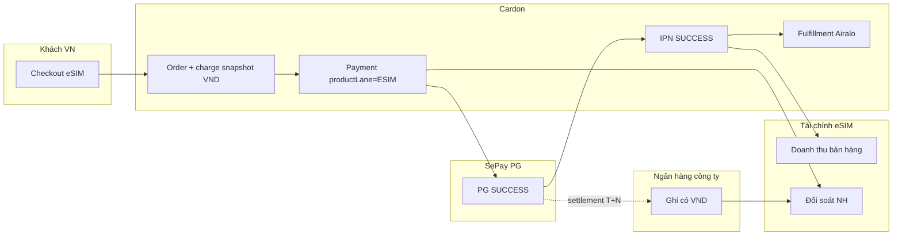
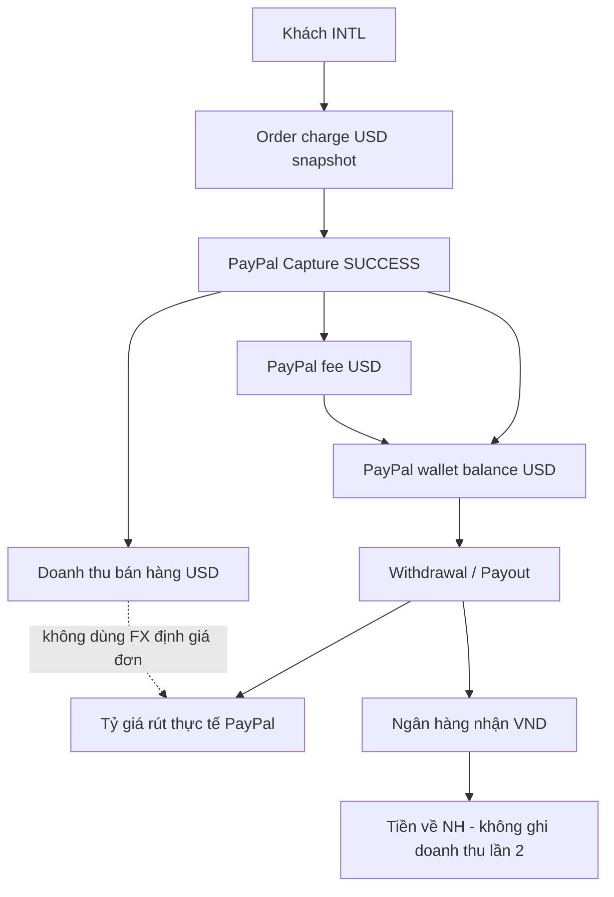
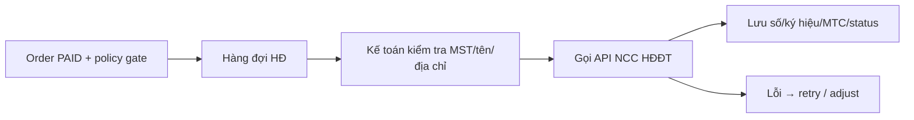

# eSIM Cardon — Kiến trúc tài chính & đối soát (nghiên cứu)

**Ngày:** 2026-11-07  
**Phạm vi:** Nghiên cứu + thiết kế. **Không** sửa code, **không** migration, **không** bật production / API live.  
**Mục tiêu:** Vận hành chuyên nghiệp, dễ dùng; tái sử dụng module Tài chính thẻ game nơi an toàn; tách rõ doanh thu bán hàng ≠ tiền thực nhận ≠ số dư ví ≠ tiền về ngân hàng.

---

## 0. Kết luận điều hành (phương án tối ưu)

**Khuyến nghị: mở rộng module Tài chính hiện tại bằng một “lane eSIM” song song — không tạo hệ thống tài chính độc lập, cũng không nhét eSIM vào báo cáo VAT/Profit VND hiện có.**

| Lựa chọn | Đánh giá |
|----------|----------|
| A. Hệ thống Finance eSIM riêng | Trùng UI/permission/audit; vận hành học 2 chỗ; từ chối |
| B. Trộn eSIM vào Profit/VAT thẻ game hiện tại | Nguy hiểm: cộng VND+USD, ProfitService chưa lọc `homeService`, VAT ESIM→OTHER chưa phê duyệt thuế; **cấm** |
| **C. Finance shell + lane eSIM (đề xuất)** | Cùng menu Tài chính, quyền `finance.*`, pattern đối soát/refund đã có; query/API/`productLane=ESIM` tách biệt; Ops giữ vận hành đơn |

**Hai mặt vận hành rõ ràng:**

1. **eSIM Ops** (`/esim-ops`) — vận hành đơn, fulfillment, KPI vận hành (đưa lên đầu trang).  
2. **Tài chính → eSIM** (`/finance/esim/...`) — kế toán: doanh thu theo currency, phí cổng, đối soát SePay/PayPal, số dư/rút PayPal, ngân hàng, hóa đơn điện tử.

---

## 1. Đánh giá Tài chính hiện tại (thẻ game / bán lẻ)

### 1.1 Menu & UX đang có

`FinanceShell` hiện là **VAT theo ngày**, không phải “P&L đa tiền tệ”:

| Route | Vai trò thực tế |
|-------|-----------------|
| `/finance/supplier` | Đối soát NCC (VAT đầu vào) |
| `/finance/retail` | HĐ đầu ra bán lẻ (tách 10%/8%) |
| `/finance/gateway-fee` | Phí cổng TT (VAT) |
| `/finance/summary` | Tổng hợp tháng |
| `/finance/dashboard`, `/payments`, `/providers` | Có file page; nav chính vẫn tập trung VAT |

Copy UI: *«Hóa đơn GTGT theo ngày — NCC · bán lẻ · phí cổng · tổng hợp. Không gồm đại lý.»*

### 1.2 Backend có thể tái sử dụng

| Thành phần | Trạng thái | Ghi chú tái sử dụng eSIM |
|------------|------------|---------------------------|
| `PaymentReconcileService` + `reconcile.engine` | **Đang hoạt động** (VND gateway report import) | Tái sử dụng **engine MATCHED/MISMATCH**; filter `productLane=ESIM` + currency |
| `Payment.reconciliationStatus` / `settlementDate` / `bankReference` | **Đang có schema** | Dùng cho đối soát ngân hàng eSIM SePay |
| `ReconcileReport` / `ReconcileItem` | **Đang có** | Thêm domain hoặc `gatewayOrProvider` + lane trong summary JSON |
| `PaymentGatewayInvoice` (period fee) | **Đang có** | Mẫu kỳ phí SePay/PayPal; **chưa** lưu fee từng capture PayPal |
| `ProfitService` / `calculateProfit` | **Đang hoạt động VND** | **Không** dùng cho eSIM USD cho đến khi có engine đa currency riêng |
| `GatewayFeesService` | **Đang hoạt động** (từ `paymentFeeAmount` trên order) | Phí **ước tính Cardon** ≠ fee PayPal thực; eSIM cần fee từ gateway |
| `InvoiceService` (B2C_RECEIPT) | **Nội bộ DRAFT** | Chưa tích hợp NCC hóa đơn điện tử live |
| `VatDailyService` | **VAT thẻ/topup** | ESIM map `OTHER` — **chưa** là quy tắc thuế được KEYON phê duyệt |
| Provider daily recon | **Đang chạy ESALE…** | **Chủ động bỏ qua** `AIRALO` / `ESIM_GO` |
| Refund recon `PENDING_VERIFY` / `VERIFIED` | **Đang có** (ops hoàn) | Pattern UX “đã chuyển ≠ đã đối soát” — học cho payout PayPal |
| eSIM Ops dashboard Phase 4 | **Đang có** | Doanh thu SUCCESS tách VND/USD/sandbox; **không** phải sổ kế toán |

### 1.3 Dữ liệu thanh toán eSIM đã lưu (bằng chứng code)

| Field | SePay eSIM | PayPal eSIM |
|-------|------------|-------------|
| `payments.productLane` | `ESIM` | `ESIM` |
| `payments.currency` | VND | USD |
| `payments.amount` | charge snapshot | charge snapshot |
| `gatewayTransactionId` / reference | Có qua IPN | Capture / order id |
| `orders.chargeAmount` / `chargeCurrency` / FX snapshot | Có (Phase 3) | Có |
| `costAmount` / `costCurrency` (Airalo) | Snapshot; thường VND cost vs USD charge → **profit unreconciled** (Phase 4) | Cùng vấn đề |
| PayPal **transaction fee / net / balance / payout** | N/A | **Chưa persist** (webhook checkout ≠ báo cáo đối soát) |
| Bank statement match | `bankReference` sẵn schema | Chưa pipeline eSIM |

**Nguyên tắc bất biến (đã đúng với Phase 3–4):** không cộng VND+USD; không dùng FX định giá đơn để thay tỷ giá rút PayPal; không ghi doanh thu lần 2 khi rút về NH.

---

## 2. Phân loại chức năng (audit)

Chú giải: **Live** = có code + đã nghiệm thu vận hành; **Partial** = có schema/engine/UI một phần; **Design-only** = mới trong tài liệu; **Missing** = chưa có.

| Hạng mục | Trạng thái | Ghi chú |
|----------|-----------|---------|
| eSIM order list + filter market/gateway | Live (Phase 4 / Ops UX) | |
| KPI/revenue báo cáo trên trang Ops (cuối trang) | Live | Khó theo dõi; thiếu phí/net/bank |
| Thanh toán eSIM list | Live | |
| Snapshot catalog/charge/cost/FX | Live | Không sửa snapshot cũ |
| Charge amount limit Phase A | Live (PASS) | Bảo vệ abuse, không phải finance |
| Doanh thu SUCCESS tách currency | Live (ops dashboard) | |
| Profit cùng currency only | Live (ops) | USD charge + VND cost → unreconciled |
| VAT pack thẻ game | Live | Không dùng chung eSIM |
| Payment reconcile import transactions | Partial | Chủ yếu retail/VND; chưa lane eSIM |
| Gateway period invoice | Partial | |
| Internal B2C invoice DRAFT | Partial | Không e-invoice API |
| SePay eSIM IPN SUCCESS | Live | ≠ đối soát NH |
| PayPal capture webhook | Live | ≠ fee/balance/payout |
| Bank statement import + MATCHED… | Missing | |
| PayPal fee/net per capture | Missing | |
| PayPal wallet balance snapshot | Missing | |
| PayPal withdrawal ↔ bank credit | Missing | |
| E-invoice provider API | Missing / Design | Cần NCC + chính sách thuế KEYON |
| Finance menu «eSIM» | Missing | |
| KPI đầu trang Ops | Design (yêu cầu này) | UX only |

---

## 3. Đề xuất giao diện & menu Admin

### 3.1 Trang Đơn hàng eSIM (`/esim-ops`)

```
┌─────────────────────────────────────────────────────────┐
│  KPI strip (đầu trang)                                  │
│  Doanh thu VND | Doanh thu USD | PAID | Fulfilling |    │
│  Completed | Cần xử lý | (sandbox badge tách)           │
├─────────────────────────────────────────────────────────┤
│  Filters: ngày · TT · fulfillment · market · gateway    │
│  Quick tabs (đã có)                                     │
├─────────────────────────────────────────────────────────┤
│  Bảng đơn                                               │
├─────────────────────────────────────────────────────────┤
│  Tabs phụ: [Gói bán chạy] [Quốc gia] [Chi tiết kinh tế] │
│  Link: «Mở Tài chính eSIM» → /finance/esim              │
└─────────────────────────────────────────────────────────┘
```

- Đưa KPI lên đầu; báo cáo gói/quốc gia → tab (không bắt cuộn cuối).  
- Không nhồi đối soát ngân hàng / PayPal payout vào Ops (tránh lẫn vai trò CS/ops vs kế toán).

### 3.2 Module Tài chính — cấu trúc đề xuất

Giữ 4 tab VAT hiện tại cho thẻ/topup. Thêm nhóm **eSIM** (hoặc SectionNav cấp 2):

| Path đề xuất | Người dùng | Nội dung |
|--------------|------------|----------|
| `/finance/esim` | Kế toán + Super Admin | Tổng quan: doanh thu VND/USD, net ước tính, open recon |
| `/finance/esim/revenue` | | Theo ngày/tháng, gateway, currency (đọc từ payment SUCCESS + snapshot) |
| `/finance/esim/fees` | | Phí Cardon vs phí gateway thực (khi có) |
| `/finance/esim/sepay-recon` | | Đối soát SePay ↔ ngân hàng |
| `/finance/esim/paypal` | | Capture · fee · balance · withdrawal |
| `/finance/esim/bank` | | Sao kê NH, MATCHED / UNMATCHED / DIFFERENCE / NEEDS_REVIEW |
| `/finance/esim/invoices` | Kế toán (permission riêng) | Hàng đợi HĐĐT |

**Quyền:** tái sử dụng `finance.view` / `finance.manage`; thêm `finance.esim_invoice` (hoặc `invoice.issue`) cho kế toán xuất HĐ — không gộp `orders.manage`.

ACCOUNTANT đã được phép `/finance` và `/esim-ops` trong route map — phù hợp nếu UI tách rõ.

---

## 4. Sơ đồ luồng tiền SePay (VND)



**Phân biệt bắt buộc:**

| Sự kiện | Ý nghĩa kế toán |
|---------|-----------------|
| SePay IPN SUCCESS | Thanh toán đơn thành công → **doanh thu / quyền fulfill** |
| Tiền vào TKNH | **Cash settlement** — chỉ sau đối soát |
| MATCHED | Kế toán xác nhận dòng NH khớp payment |

---

## 5. Sơ đồ luồng tiền PayPal (USD → ví → NH VND)



Chuỗi đối soát chuẩn:

`Cardon Order → Payment(capture) → GatewayFee → BalanceSnapshot → Payout → BankTransaction → ReconcileMatch`

Webhook checkout **không** thay thế Transaction Search / Reporting / CSV payout.

---

## 6. Quy trình đối soát & chênh lệch

### 6.1 Trạng thái đề xuất (thống nhất SePay + PayPal + NH)

| Status | Ý nghĩa |
|--------|---------|
| `MATCHED` | Khớp reference + amount + currency |
| `UNMATCHED` | Có một phía (Cardon hoặc external) |
| `DIFFERENCE` | Cùng reference, lệch số tiền/phí |
| `NEEDS_REVIEW` | Cần người xử lý (refund/reversal/partial) |

Kế thừa tinh thần `reconcile.engine` + UX refund `PENDING_VERIFY` ≠ “đã chuyển tiền”.

### 6.2 SePay

1. Nguồn A: `payments` SUCCESS, `productLane=ESIM`, gateway SEPAY.  
2. Nguồn B: API giao dịch SePay **hoặc** CSV/sao kê NH (ưu tiên sao kê NH công ty nếu API PG không đủ settlement).  
3. Match key: `paymentReference` / `gatewayTransactionId` / nội dung CK.  
4. Lưu `ReconcileReport` + cập nhật `payments.reconciliationStatus`, `bankReference`, `settlementDate`.  
5. Audit: ai chạy, ai xác nhận.

### 6.3 PayPal

1. **Layer 1 — Sales:** Transaction Search / CSV Activity → gross, fee, net, capture id ↔ `payments`.  
2. **Layer 2 — Wallet:** Balance API hoặc báo cáo số dư định kỳ (snapshot đầu/cuối kỳ).  
3. **Layer 3 — Payout:** CSV/API withdrawal ↔ dòng NH VND (tỷ giá **rút**, không phải FX snapshot đơn).  
4. Refund/reversal: nối `RefundRequest` / attempt đã có.

### 6.4 Xử lý lệch

- Ops không tự “sửa” amount đơn/payment lịch sử.  
- Kế toán tạo **adjustment note** trên reconcile item (lý do, evidence).  
- Không backfill đổi snapshot giá.

---

## 7. Quy trình hóa đơn điện tử VAT

### 7.1 Hiện trạng

- `Invoice` nội bộ: DRAFT/B2C_RECEIPT — **không** phải HĐĐT cơ quan thuế.  
- VAT daily: ESIM → `OTHER` — ghi rõ trong test *«technical default, not an approved tax rule»*.

### 7.2 Đề xuất (sau phê duyệt thuế KEYON)



**Cấm auto-issue** khi SePay SUCCESS hoặc tiền vừa vào NH.

Cần KEYON chốt trước khi code:

- Thời điểm lập HĐ (thanh toán vs kích hoạt eSIM vs kỳ kê khai).  
- Thuế suất / ngành nghề eSIM.  
- NCC (Viettel, FPT, EasyInvoice, …) và môi trường sandbox.

Permission riêng kế toán; chống trùng theo `orderId` + trạng thái đã phát hành.

---

## 8. Thiết kế dữ liệu / API dự kiến (chưa migration)

### 8.1 Nguyên tắc

- Bảng mới **lane-aware** hoặc cột `product_lane`; query eSIM luôn `productLane = 'ESIM'`.  
- Không sửa row payment/order đã hoàn thành để “vá” báo cáo.  
- Append-only cho balance snapshot, reconcile reports, payout links.

### 8.2 Thực thể đề xuất (logic)

| Entity | Mục đích | Đã có / mới |
|--------|----------|-------------|
| `payments` (+ fee_gross/fee_net optional sau) | Giao dịch bán | Có; mở rộng fee PayPal |
| `gateway_fee_lines` | Fee theo capture/refund | **Mới** (hoặc JSON có kiểm soát) |
| `gateway_balance_snapshots` | Số dư ví theo currency/thời điểm | **Mới** |
| `gateway_payouts` | Lệnh rút PayPal | **Mới** |
| `bank_transactions` | Sao kê NH import | **Mới** |
| `reconcile_reports` / items | Kết quả đối soát | Có — mở rộng domain/summary |
| `einvoices` | HĐĐT NCC | **Mới** (tách khỏi `invoices` nội bộ) |

### 8.3 API phác thảo (admin)

| Area | Ví dụ |
|------|--------|
| Revenue | `GET /admin/finance/esim/revenue?from&to` — totals by currency/gateway |
| Sepay recon | `POST /admin/finance/esim/reconcile/sepay` (upload/API pull) |
| PayPal sync | `POST /admin/finance/esim/paypal/import` (CSV) / later API pull |
| Balances | `GET /admin/finance/esim/paypal/balances` |
| Payouts | `GET/POST .../paypal/payouts` |
| Bank | `POST .../bank/import` |
| E-invoice | `GET/POST .../einvoices` |

Mọi endpoint: `finance.view` / `finance.manage`; không đụng PaymentService checkout.

---

## 9. Khả năng tái sử dụng module Tài chính thẻ game

| Pattern thẻ game | Áp dụng eSIM | Cách làm cho “dễ dùng” |
|------------------|--------------|-------------------------|
| Shell + date range + quyền finance | Có | Thêm section eSIM trong cùng module |
| Payment reconcile engine | Có | Filter lane + currency; UI giống “đối soát nhận tiền” |
| `reconciliationStatus` trên payment | Có | Badge trên list finance eSIM |
| Gateway invoice theo kỳ | Có | SePay/PayPal fee invoice kỳ |
| Provider daily recon | **Không** copy Airalo vào cron ESALE | Airalo cost dùng snapshot đơn / báo cáo riêng |
| ProfitService VND | **Không** | Engine `EsimEconomics` (đã có mầm trong ops dashboard) |
| VAT 8%/10% packs | **Không** cho đến phê duyệt thuế | Tab HĐĐT eSIM riêng |
| Refund VERIFY UX | Có | Copy wording “đã rút ≠ đã đối soát NH” |

**Công thức vận hành giống thẻ game (mental model):**

1. Xem doanh thu bán (ops/finance revenue).  
2. Đối soát cổng.  
3. Đối soát tiền về NH.  
4. (Sau này) Xuất HĐ.

Khác biệt eSIM: **hai currency + ví PayPal trung gian**.

---

## 10. Rủi ro & bảo vệ

| Rủi ro | Biện pháp |
|--------|-----------|
| Cộng VND+USD vào KPI cũ | API/UI luôn tách currency; test cấm sum chéo |
| Lẫn SePay agent wallet | Chỉ `productLane=ESIM`; không đụng deposit webhook |
| Sửa IPN/webhook đã nghiệm thu | Recon **đọc** payment; không đổi state machine checkout |
| Dùng FX snapshot đơn cho payout | Cột `payout_fx` riêng |
| Double-count doanh thu khi rút PayPal | Payout chỉ tăng cash bank, không tăng revenue |
| ProfitService nuốt eSIM | Giữ exclusion / không gọi cho lane ESIM |
| Admin-test/sandbox vào sổ | Tiếp tục `EXCLUDE_ADMIN_TEST` + tách commerce/sandbox như Phase 4 |
| Auto e-invoice sai thời điểm | Manual queue + policy KEYON |
| API PayPal thiếu payout detail | Fallback CSV báo cáo chính thức |

---

## 11. Lộ trình phase (ưu tiên)

| Phase | Tên | Nội dung | Phụ thuộc | Nghiệm thu chính |
|-------|-----|----------|-----------|------------------|
| **F0** | UX Ops KPI | KPI đầu trang Ops; tab gói/quốc gia; link sang Finance | Không API ngoài | Ops không cần cuộn cuối để thấy doanh thu VND/USD |
| **F1** | Finance eSIM Revenue | Menu `/finance/esim`, báo cáo đọc payment SUCCESS + snapshot, tách sandbox, export | F0 | Số khớp Phase 4 dashboard; không đụng retail VAT |
| **F2** | SePay ↔ Bank recon | Import sao kê / API; MATCHED…; cập nhật payment recon fields | F1; mẫu sao kê NH | Case lệch amount/missing phát hiện được; audit đủ |
| **F3** | PayPal sales + fee | Import/API Transaction Search; gross/fee/net gắn capture | F1; PayPal Business KEYON | Fee không suy từ FX đơn; khớp CSV mẫu |
| **F4** | PayPal balance + payout ↔ NH | Snapshot số dư; payout; match NH VND | F3 | Chuỗi Order→…→Bank; không double revenue |
| **F5** | E-invoice | NCC sandbox; queue; permission kế toán | F1 + **phê duyệt thuế KEYON** | Không auto từ IPN; chống trùng |

**Thứ tự cứng:** F0 → F1 → (F2 ∥ F3) → F4 → F5.  
F5 có thể trễ nếu thuế chưa chốt.

**Không** gộp vào Phase B security daily-limit hay Phase 5 fulfillment product.

---

## 12. Test & tiêu chí nghiệm thu theo phase

### F0
- [ ] KPI VND và USD hiển thị đầu trang, không cộng chung.  
- [ ] Sandbox không trộn commerce.  
- [ ] Regression `esim-ops` vitest / list filters.

### F1
- [ ] Totals = cùng công thức Phase 4 (`esim-ops-dashboard`).  
- [ ] Retail `/finance/supplier|retail|…` không đổi số khi có đơn eSIM.  
- [ ] Admin-test excluded.

### F2
- [ ] Fixture: match / missing bank / wrong amount.  
- [ ] Không gọi SePay IPN handler.  
- [ ] `reconciliationStatus` cập nhật đúng; audit userId.

### F3–F4
- [ ] CSV PayPal mẫu: fee + net.  
- [ ] Payout không tăng “doanh thu”.  
- [ ] FX payout ≠ FX order snapshot.  
- [ ] Isolation: `esim-paypal-payment` / `esim-sepay-payment` suites vẫn PASS.

### F5
- [ ] Issue/void/adjust theo API NCC sandbox.  
- [ ] Cấm issue khi chưa đủ điều kiện policy.  
- [ ] Quyền kế toán vs ops.

### Pre-prod (từ Phase A completion — vẫn mở)
- [ ] Retail PaymentService / order amount limits  
- [ ] Agent-wallet SePay  
- [ ] Redis/BullMQ không enqueue khi order bị chặn limit  

---

## 13. Ma trận hạng mục (đã có / tái sử dụng / API / rủi ro)

| Hạng mục | Đã có? | Tái sử dụng? | API bên 3 | Rủi ro | Kiểm thử | AC |
|----------|--------|--------------|-----------|--------|----------|-----|
| Ops KPI đầu trang | Partial UI | Có dashboard API | — | Thấp | Vitest + browser | F0 |
| Finance eSIM revenue | Partial (ops only) | Có engine báo cáo | — | Nhầm sandbox | So khớp Phase 4 | F1 |
| SePay bank recon | Partial schema | Có reconcile engine | SePay + NH CSV | Nhầm agent wallet | Fixture match | F2 |
| PayPal fee/net | Chưa | Pattern gateway invoice | PayPal Reporting/CSV | Webhook ≠ recon | CSV golden | F3 |
| PayPal balance/payout | Chưa | Mới + bank match | PayPal + NH | Double count | Chuỗi E2E sổ | F4 |
| E-invoice | Chưa (nội bộ khác) | Invoice queue UX | NCC HĐĐT | Sai thời điểm/thuế | Sandbox NCC | F5 |
| Profit đa currency | Unreconciled | **Engine mới**, không ProfitService | — | FX sai | Unit cấm convert ngầm | Trước F1 profit tab |

---

## 14. Việc **không** làm trong các phase trên

- Không đụng checkout SePay/PayPal eSIM, Airalo fulfill, agent ledger/wallet.  
- Không merge doanh thu eSIM vào VAT thẻ game.  
- Không bật production / không gọi API live ngoài phạm vi phase được duyệt.  
- Không migration cho đến khi phase được phê duyệt thiết kế chi tiết (F2+).

---

## 15. Quyết định chủ dự án (đã chốt 2026-11-07)

Xem `esim-finance-decisions-lock.md`. Tóm tắt:

1. **Phương án C** — đã chốt.  
2. Thứ tự: F0 → F1 → **F2 trước** → F3 (thiết kế song song) → F4 → F5.  
3. PayPal giai đoạn đầu: **CSV-first**, schema sẵn cho API sau.  
4. HĐĐT: khảo sát NCC trước; không phát hành cho đến KEYON duyệt thuế.

Kế hoạch F0/F1: `esim-finance-f0-f1-implementation-plan.md`.  
Thiết kế F2/F3: `esim-finance-f2-f3-technical-design.md`.  
Khảo sát HĐĐT: `esim-einvoice-provider-survey.md`.
