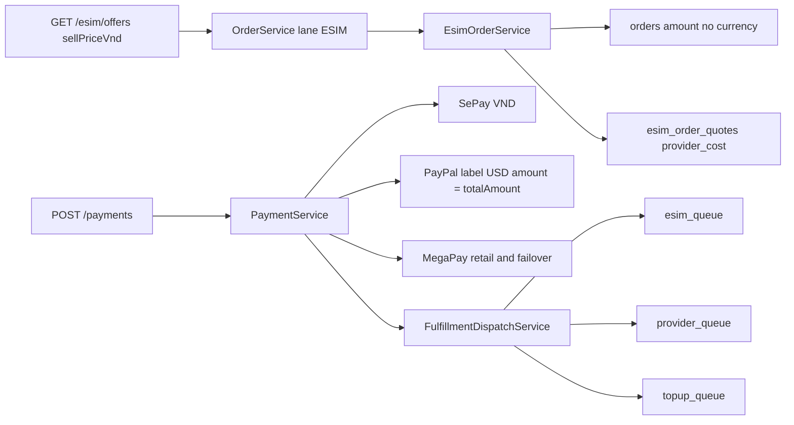
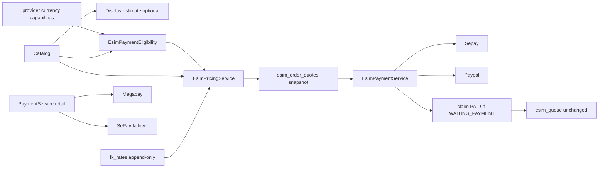
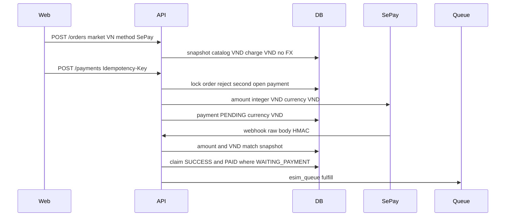
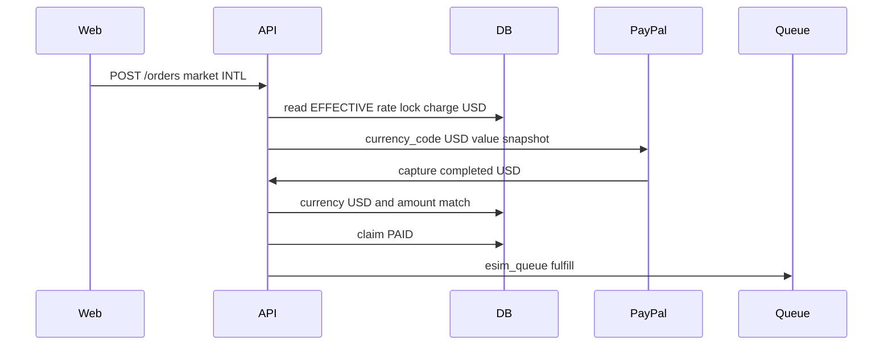
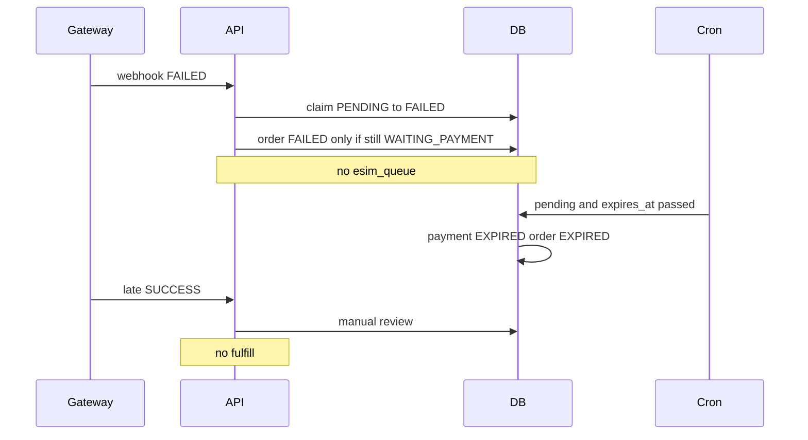
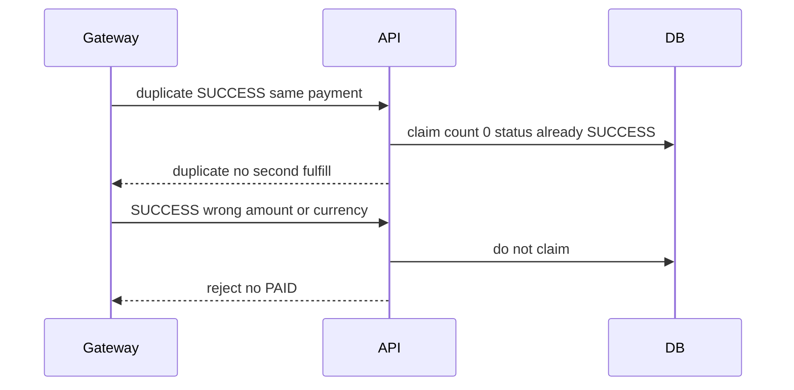
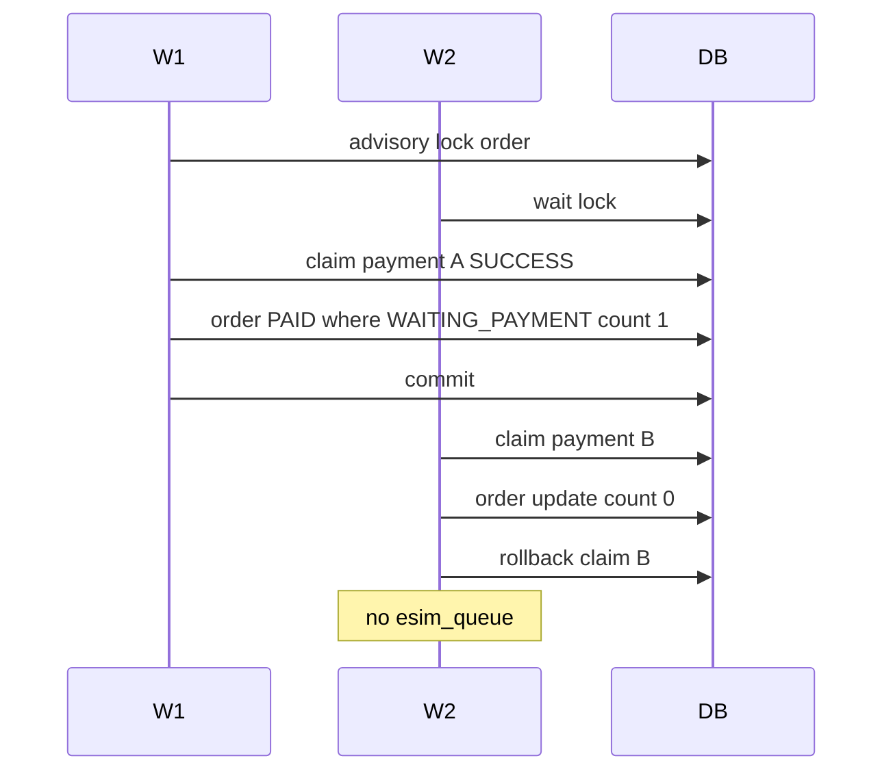
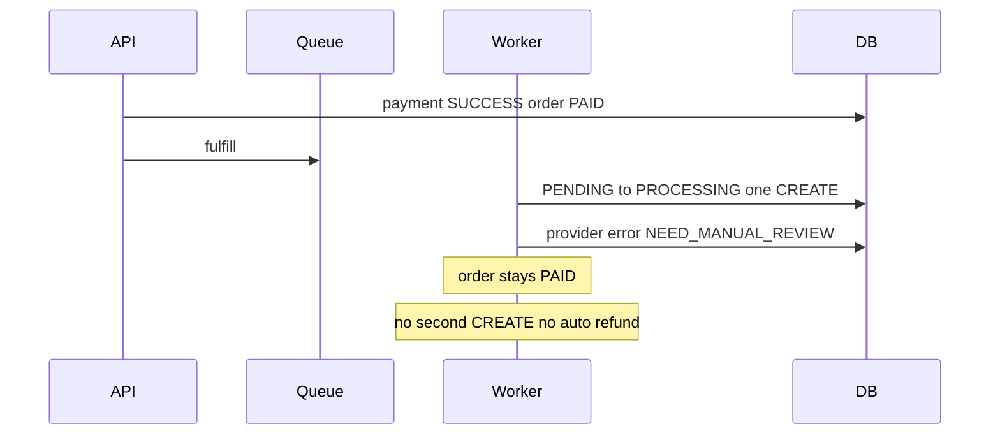
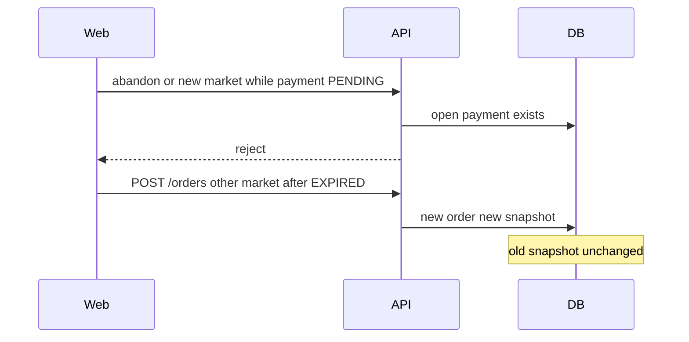
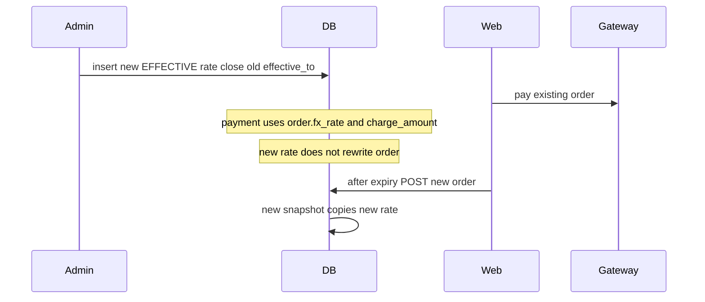

# Thiết kế kiến trúc Multi-Currency và Payment cho eSIM

Trạng thái: **DESIGN ONLY**. Tài liệu này không triển khai schema, không sửa code, không gọi cổng thanh toán.

Nguồn sự thật hiện tại: `docs/esim/multi-currency-flow-audit.md`, đối chiếu code và database local. Production chưa được query.

Nhãn dùng trong toàn bộ báo cáo:

| Nhãn | Nghĩa |
| --- | --- |
| Đã xác minh | Có trong code, schema hoặc database local |
| Đề xuất | Thiết kế mới, chưa có trong hệ thống |
| Chưa xác minh | Không được coi là đúng cho đến khi có bằng chứng |
| Cần quyết định | Chủ sản phẩm phải chốt trước khi triển khai |

## 1. Executive Summary

eSIM của Cardon tiếp tục định giá gốc bằng VND. Backend tính số tiền khách phải trả. SePay chỉ được thiết kế để thu VND. PayPal chỉ được thiết kế để thu USD, và số gửi sang PayPal phải là USD đã snapshot, không phải số VND gắn nhãn USD.

Đã xác minh: `orders` và `payments` không có cột currency. `esim_order_quotes` chỉ lưu giá vốn tại lúc tạo đơn. PayPal adapter từ chối currency khác USD, nhưng `PaymentService.createPayment` đang đưa `orders.total_amount` vào lệnh USD. SePay Payment Gateway gửi `currency: 'VND'`. Local có một đơn admin-test PayPal: đơn `103000.00`, payment `1.00`, cả hai `EXPIRED`. `usd_vnd_rate = 26000` trên 2.098 gói local không được dùng làm tỷ giá bán.

Đề xuất: thêm snapshot tiền tệ cho riêng eSIM, một sổ tỷ giá append-only với nguồn chưa chọn, và một cổng thanh toán eSIM riêng gọi adapter hiện có. Luồng thẻ, nạp, MegaPay, failover MegaPay → SePay và ví đại lý giữ nguyên hành vi. Cấp phát eSIM vẫn chỉ sau payment `SUCCESS` và order `PAID`, một CREATE cho mỗi order item.

USD cho khách chỉ được bật khi cùng lúc có: nguồn tỷ giá đã được duyệt, capability PayPal/USD đã được xác nhận ở merchant, snapshot ghi đủ, và cờ `ESIM_USD_CHECKOUT_ENABLED`. Trước thời điểm đó, checkout khách PayPal phải tắt, không được tiếp tục gửi số VND dưới nhãn USD.

## 2. Current Architecture

Đã xác minh.



Các điểm giữ nguyên vì đã đúng với nghiệp vụ:

- Giá không đến từ frontend. `startEsimVnCheckout` chỉ gửi variant, số lượng 1, method, market, locale.
- Phí cổng là ước tính merchant chịu. Khách trả giá bán đã làm tròn, không cộng phí vào số phải trả (`payment-fee.engine.ts`).
- Webhook không gọi Airalo. Sau commit `PAID`, dispatch `esim_queue` job id `esim-fulfill-{orderId}`, `attempts: 1`.
- `open_guard` unique, `request_id` unique, profile unique theo `order_item_id`.
- Hết hạn payment là cron `ExpirationCronService`, không phải worker `payment_queue`.
- Đơn eSIM không đi `buyCard` / `topup`. Đơn trộn eSIM với sản phẩm khác bị từ chối.
- Market eSIM lấy từ body (`VN` mặc định, `INTL` nếu gửi). Không lấy từ locale. Comment trong `esim-market.rules.ts` nói truth là market + currency + gateway, không phải IP.
- Cặp đang code: VN + VND + SEPAY, hoặc INTL + USD + PAYPAL. Rule này không tự đổi số VND thành USD.
- Cửa sổ thanh toán eSIM: `DEFAULT_PAYMENT_TIMEOUT_MINUTES = 15`.
- Admin test PayPal sandbox không enqueue fulfillment.

Các điểm không được mang sang thiết kế mới:

- Suy currency bằng “PayPal = USD, còn lại = VND” trong eSIM ops dashboard.
- `ProfitService` cộng `total_amount` và trả `currency: 'VND'`.
- `createPayment` cho phép đơn eSIM SePay nhận `gateway: MEGAPAY` nếu client tự gửi.
- `markPaidInTransaction` cập nhật trạng thái đơn không có điều kiện `WHERE payment_status = WAITING_PAYMENT`.
- Cột `esim_airalo_packages.usd_vnd_rate`.

## 3. Target Architecture

Đề xuất. eSIM có lớp giá và lớp thu riêng. Adapter SePay và PayPal được gọi với amount và currency đã khóa. `PaymentService` của bán lẻ không đổi công thức amount.



Ranh giới:

| Việc | Module đề xuất | Được phép đổi hành vi bán lẻ |
| --- | --- | --- |
| Giá catalog, FX, charge, làm tròn USD | `EsimPricingService` | Không |
| Market, currency, capability | `EsimPaymentEligibility` | Không |
| Tạo payment eSIM, khóa một payment mở | `EsimPaymentService` | Không |
| Gửi form SePay VND, gọi PayPal Orders v2 | Adapter hiện có | Không đổi contract retail |
| Claim `PAID` cho eSIM | Hàm mới `claimEsimPaid` | Không gọi đè `markPaidInTransaction` của retail trong đợt đầu |
| Cấp phát | `EsimFulfillmentService` hiện có | Không thêm điều kiện currency |
| Báo cáo eSIM theo currency | API finance eSIM mới | `ProfitService` giữ nguyên đến khi có ticket riêng |
| Thẻ, nạp, MegaPay, ví | Module hiện tại | Cấm sửa ngầm |

`POST /api/v1/orders` vẫn là cửa vào. `OrderService` tiếp tục tách lane eSIM. Lane eSIM gọi pricing mới. Lane còn lại không đọc FX và không ghi cột charge.

### Hợp đồng điều phối

Đã xác minh các cửa thanh toán đang dùng chung: `POST /payments` vào `PaymentService.createPayment`, webhook vào `PaymentService.handleWebhook`, và trang PayPal return gọi `syncFromGateway`. Cả webhook lẫn sync đều có thể gọi `markPaidInTransaction` rồi dispatch. `notifyPaymentSuccess` gửi `orders.total_amount` không kèm currency.

Đề xuất, bắt buộc trước khi có đơn USD:

- `POST /payments`: nếu mọi dòng của đơn là eSIM, trả về ngay từ `EsimPaymentService`. Không chạy đoạn gán `amount = total_amount` và `currency = USD` khi gateway là PayPal. Không chạy failover MegaPay → SePay.
- Webhook đơn và `syncFromGateway`: nếu payment có `product_lane = ESIM`, chuyển sang settlement eSIM. Nhánh retail phía dưới giữ nguyên thứ tự và lời gọi hiện tại.
- Webhook nạp ví vẫn chạy trước cả hai nhánh, trong `payment.controller.ts`.
- Settlement eSIM gọi `claimEsimPaid`. Không gọi `markPaidInTransaction`.
- Đơn eSIM charge VND được gọi `notifyPaymentSuccess` như hiện tại, vì `total_amount` vẫn là số VND khách trả.
- Đơn eSIM charge USD không gọi `notifyPaymentSuccess` cho đến khi template nhận charge amount và currency. `notifyEsimReady` hiện không in số tiền. Đã xác minh phần này. Giữ nguyên với cả hai currency.

Locale VI/EN chỉ đổi chữ hiển thị. Market thương mại nằm trên sản phẩm hoặc gói đã publish, giá trị `VN` hoặc `INTL`. Checkout đọc field đó. Khách, ngôn ngữ, IP và phương thức thanh toán không được ghi market. Gói chưa có market không được bán quốc tế. Dòng catalog cũ chưa có field được coi là `VN` chỉ như quy tắc tương thích, không phải cách gán market cho gói mới.

## 4. Data Model

Đề xuất schema. Chưa có migration.

Bốn currency không được gộp:

| Lớp | Ý nghĩa | Nguồn | Có được suy từ lớp khác |
| --- | --- | --- | --- |
| Catalog | Giá bán gốc trên variant / `sell_price_vnd` | Catalog Cardon | Không |
| Cost | Giá vốn nhà cung cấp đúng đơn vị nhà cung cấp | Payload provider khi import | Không. Không mặc định bằng catalog |
| Charge | Số tiền và currency thực sự gửi sang cổng | Snapshot lúc tạo đơn | Không lấy từ frontend |
| Display | Số ước tính trên storefront | FX đang hiệu lực, chỉ để đọc | Không phải cam kết thu tiền |

### 4.1 `orders`

Cột tiền hiện có giữ nguyên ý nghĩa catalog VND cho đơn cũ và cho đơn eSIM mới: `sell_amount`, `face_value`, `total_amount`, `customer_paid`, `provider_cost`, `payment_fee_*`, `profit`. Đã xác minh các cột này là `Decimal(18,2)` và không có currency.

Với đơn eSIM mới, `total_amount` và `customer_paid` tiếp tục là số catalog VND khách thấy trên giá gốc, không bị ghi đè bằng số USD. Số thực thu nằm ở cột charge. Việc này tránh lặp lại kiểu admin-test: một cột vừa là 103000 vừa bị hiểu là USD.

| Trường | Kiểu | Null / default | Ai ghi | Khi nào | Bất biến sau khi tạo đơn |
| --- | --- | --- | --- | --- | --- |
| `catalog_currency` | `CHAR(3)` | Null với đơn cũ. eSIM mới luôn `VND` | `EsimOrderService` trong transaction tạo đơn | Lúc insert | Có. Không UPDATE |
| `catalog_amount` | `DECIMAL(18,2)` | Null đơn cũ. eSIM mới = giá bán catalog trước phí cổng | Cùng transaction | Lúc insert | Có |
| `charge_currency` | `CHAR(3)` | Null đơn cũ. eSIM mới `VND` hoặc `USD` | Cùng transaction | Lúc insert | Có |
| `charge_amount` | `DECIMAL(18,2)` | Null đơn cũ. eSIM mới = số gửi sang cổng | Cùng transaction | Lúc insert | Có |
| `cost_currency` | `CHAR(3)` | Null nếu provider chưa có currency | Cùng transaction, copy từ gói | Lúc insert | Có |
| `cost_amount` | `DECIMAL(18,4)` | Null nếu chưa có giá vốn gốc | Cùng transaction | Lúc insert | Có |
| `fx_rate_id` | `UUID` | Null khi charge là VND và không cần quy đổi | Cùng transaction | Lúc insert | Có |
| `fx_rate` | `DECIMAL(18,8)` | Null khi không quy đổi | Copy từ dòng `fx_rates` | Lúc insert | Có. Không cập nhật khi sổ FX đổi |
| `fx_as_of` | `TIMESTAMPTZ` | Null khi không quy đổi | Copy `effective_from` | Lúc insert | Có |
| `esim_market` | `VARCHAR(8)` | Null đơn không phải eSIM. Giá trị `VN` hoặc `INTL` | Cùng transaction | Lúc insert | Có |
| `pricing_locked_at` | `TIMESTAMPTZ` | Null đơn cũ | Cùng transaction | Lúc insert | Có |

`provider_cost` hiện là `Decimal(18,2)` không currency. Đề xuất: đơn mới vẫn ghi `provider_cost` chỉ khi cost currency là VND, để báo cáo cũ không đọc nhầm USD thành VND. Khi cost currency khác VND, `provider_cost` để null trên đơn eSIM mới và số gốc nằm ở `cost_amount` + `cost_currency`. Đơn cũ không bị viết lại.

Retail và đại lý không ghi các cột mới. Null nghĩa là “chưa có snapshot”, không nghĩa là USD.

### 4.2 `payments`

| Trường | Kiểu | Null / default | Ai ghi | Khi nào | Bất biến |
| --- | --- | --- | --- | --- | --- |
| `amount` | Đã có `DECIMAL(18,2)` | Bắt buộc như hiện tại | `EsimPaymentService` copy `charge_amount` | Lúc tạo payment | Có. Webhook không sửa |
| `currency` | `CHAR(3)` | Null = dòng cũ hoặc retail chưa backfill | `EsimPaymentService` copy `charge_currency` | Lúc tạo payment | Có |
| `product_lane` | `VARCHAR(16)` | Null với retail. eSIM ghi `ESIM` | `EsimPaymentService` | Lúc tạo payment | Có |
| `fx_rate_id` | `UUID` | Null nếu không quy đổi | Copy từ đơn | Lúc tạo payment | Có |

Index đề xuất, chỉ hàng eSIM:

```text
UNIQUE (order_id)
WHERE product_lane = 'ESIM'
  AND status IN ('PENDING', 'SUCCESS')
  AND deleted_at IS NULL
```

PostgreSQL cho nhiều dòng `product_lane` null trong unique index. Retail không bị cấm tạo payment như hiện tại.

### 4.3 `esim_order_quotes`

Đã xác minh: một quote cho một `order_item_id`, tạo trong transaction đơn, không TTL. Đề xuất mở rộng chính bảng này thành pricing snapshot. Không tạo quote trước khi có đơn, vì cam kết giá bắt đầu lúc insert đơn, trùng cửa sổ 15 phút đã có.

| Trường | Kiểu | Null | Ai ghi | Khi nào | Bất biến |
| --- | --- | --- | --- | --- | --- |
| `provider_cost` | Đã có | Giữ cho dòng cũ | Giữ writer hiện tại với đơn cũ | Insert | Có |
| `catalog_currency` | `CHAR(3)` | Null dòng cũ | Transaction đơn | Insert | Có |
| `catalog_unit_amount` | `DECIMAL(18,2)` | Null dòng cũ | Transaction đơn | Insert | Có |
| `cost_currency` | `CHAR(3)` | Null nếu import không có currency | Transaction đơn, copy gói | Insert | Có |
| `cost_amount` | `DECIMAL(18,4)` | Null nếu không có số gốc | Transaction đơn | Insert | Có |
| `charge_currency` | `CHAR(3)` | Null dòng cũ | Transaction đơn | Insert | Có |
| `charge_amount` | `DECIMAL(18,2)` | Null dòng cũ | Transaction đơn | Insert | Có |
| `fx_rate_id` | `UUID` | Null nếu không quy đổi | Transaction đơn | Insert | Có |
| `fx_rate` | `DECIMAL(18,8)` | Null nếu không quy đổi | Copy sổ | Insert | Có |
| `fx_as_of` | `TIMESTAMPTZ` | Null nếu không quy đổi | Copy sổ | Insert | Có |
| `display_currency` | `CHAR(3)` | Null | Không dùng làm số thu. Chỉ ghi nếu UI đã hiện ước tính và chủ sản phẩm muốn lưu | Insert | Có |
| `snapshot_at` | `TIMESTAMPTZ` | Null dòng cũ | Transaction đơn | Insert | Có |

Không thêm `expires_at` cho FX. Hết hạn thanh toán vẫn là `orders.payment_expires_at`. Sau hạn, snapshot còn để đối soát nhưng không được thu tiếp.

### 4.4 FX

Định nghĩa đề xuất, cần quyết định trước khi code: `fx_rates.rate` = số VND cho 1 USD. Chiều ngược lại bị cấm trong API. Không đọc `esim_airalo_packages.usd_vnd_rate`.

`fx_rate_sources`:

| Trường | Kiểu | Ghi chú |
| --- | --- | --- |
| `code` | `VARCHAR(32)` PK | Không seed nhà cung cấp nào ở trạng thái dùng được |
| `status` | enum `PENDING_APPROVAL`, `APPROVED`, `DISABLED` | Mặc định thiết kế: không có dòng `APPROVED` |
| `base_currency` | `CHAR(3)` | `USD` trong cặp đã định nghĩa |
| `quote_currency` | `CHAR(3)` | `VND` |
| `max_staleness_seconds` | `INT` | Cần quyết định. Đề xuất khởi điểm 86400, chưa chốt |
| `fetch_interval_seconds` | `INT` | Cần quyết định. Đề xuất khởi điểm 3600, chưa chốt |

`fx_rates` append-only:

| Trường | Kiểu | Ghi chú |
| --- | --- | --- |
| `id` | `UUID` | |
| `source_code` | FK | |
| `rate` | `DECIMAL(18,8)` | VND cho 1 USD. Check `rate > 0` |
| `effective_from` | `TIMESTAMPTZ` | Bắt đầu hiệu lực |
| `effective_to` | `TIMESTAMPTZ` null | Đóng khi có rate mới được duyệt. Không sửa `rate` |
| `observed_at` | `TIMESTAMPTZ` | Lúc nguồn báo giá. Không dùng làm lúc khách mở trang |
| `published_by` | `UUID` null | Admin. Job tự động chỉ được insert `PENDING_REVIEW` |
| `status` | `DRAFT`, `PENDING_REVIEW`, `EFFECTIVE`, `SUPERSEDED`, `REJECTED` | Checkout chỉ đọc đúng một dòng `EFFECTIVE` |
| `band_result` | `VARCHAR(32)` | `WITHIN_BAND` hoặc `OUTSIDE_BAND` |
| `created_at` | `TIMESTAMPTZ` | |

Audit: mỗi lần insert rate ghi audit log `FX_RATE_PUBLISHED` hoặc `FX_RATE_REJECTED` với id rate, actor, rate cũ, rate mới, phần trăm lệch. Không lưu secret nguồn FX trong log.

### 4.5 Provider currency capability

Bảng mới `payment_provider_currency_capabilities`. Không suy capability từ chỗ adapter nhận một tham số currency.

| Trường | Kiểu | Ghi chú |
| --- | --- | --- |
| `gateway` | enum hiện có | `SEPAY`, `PAYPAL`. MegaPay không có dòng eSIM |
| `currency` | `CHAR(3)` | |
| `product_lane` | `VARCHAR(16)` | `ESIM` |
| `enabled` | `BOOLEAN` | |
| `verification_status` | `UNVERIFIED`, `VERIFIED`, `REJECTED` | |
| `verified_at` | `TIMESTAMPTZ` null | |
| `settlement_currency` | `CHAR(3)` null | Chỉ điền khi hợp đồng xác nhận |
| `evidence` | `TEXT` | Ví dụ “adapter sepay.pg.ts gửi VND”. Không phải chứng nhận merchant |

Trạng thái thiết kế ban đầu, phần merchant vẫn chưa xác minh:

| Gateway | Currency | Enabled | Verification | Căn cứ |
| --- | --- | --- | --- | --- |
| SEPAY | VND | true | VERIFIED ở mức code gửi VND | Đã xác minh `sepay.pg.ts` |
| SEPAY | USD | false | UNVERIFIED | Chưa xác minh hợp đồng, merchant, API, webhook, settlement |
| PAYPAL | USD | false cho khách đến khi đủ điều kiện mục 10 | Code đã khóa USD | Đã xác minh adapter. Merchant production chưa xác minh trong audit |
| PAYPAL | VND | false | REJECTED trong thiết kế này | Adapter từ chối khác USD |

Unique `(gateway, currency, product_lane)`.

### 4.6 Đơn cũ và admin-test

Đã xác minh local: không có cột currency; một payment PayPal `1.00` gắn đơn catalog `103000.00`; refund table trống.

Quy tắc đọc, không UPDATE trong thiết kế này:

| Dòng | Cách đọc | Được vào tổng VND | Được vào tổng USD |
| --- | --- | --- | --- |
| Không phải PayPal, cột mới null | Legacy VND. Amount hiện có là VND | Có, sau khi backfill hoặc qua reader legacy | Không |
| PayPal và `client_trace.adminTest` | Catalog VND trên đơn, charge thử trên payment | Không | Không. Loại bằng cờ admin test đã có |
| PayPal khách, cột mới null, `payment.amount` khác `orders.total_amount` | `UNVERIFIED_SPLIT` | Không | Không, cho đến khi phân loại tay |
| PayPal khách, cột mới null, hai amount bằng nhau | `UNVERIFIED_PAYPAL` | Không | Không, cho đến khi phân loại tay |
| PayPal không có capture id, transaction id, hoặc provider reference | `NO_PROVIDER_EVIDENCE` | Không | Không. Không hoàn tự động |
| eSIM mới có snapshot | Đọc đúng cột | Chỉ nếu `charge_currency = VND` | Chỉ nếu `charge_currency = USD` |

Đã xác minh `inferRefundCurrency`: PayPal trả về USD, gateway khác trả về VND, vì payment chưa có cột currency. Hàm này không được dùng cho đơn eSIM mới và không được dùng khi payment PayPal chưa có `currency`. Hoàn tiền eSIM mới đọc `payments.currency` và `payments.amount`. Không đọc `orders.total_amount` làm số hoàn khi hai số khác nhau. Admin-test không đi vào hoàn production.

Cấm câu SQL `CASE WHEN gateway = 'PAYPAL' THEN 'USD' ELSE 'VND' END` trong báo cáo mới.

## 5. Payment Flow

### 5.1 Các bước

1. **Catalog.** `GET /esim/offers` trả giá bán VND. Có thể kèm ước tính display nếu có rate `EFFECTIVE`. Ước tính mang `displayOnly: true`. Không ghi quote. Không gọi API FX.
2. **Pricing.** `EsimPricingService` đọc variant `sell_price` và giá vốn gốc. Cost currency lấy từ gói. Nếu gói không có cost currency thì cost để null và đơn vẫn tạo được với VND, nhưng báo cáo lợi nhuận ghi `cost_unknown`. Không copy `VND` vào cost khi dữ liệu nguồn thiếu.
3. **FX.** Chỉ khi charge sẽ là USD. Chọn một rate `EFFECTIVE`, `effective_from <= now`, `effective_to` null hoặc còn hiệu lực, mới nhất. Rate được copy vào snapshot. Trang catalog chỉ đọc rate đã lưu, cache bộ nhớ theo TTL của tiến trình, không gọi nhà cung cấp.
4. **Eligibility.** Market đọc từ gói đã publish. VN chỉ các phương thức SePay Payment Gateway đang được bật và merchant đã được cấp: QR chuyển khoản, NAPAS nếu có cờ quyền, thẻ chỉ khi SePay đã xác nhận. INTL chỉ PayPal + USD khi capability USD enabled, rate còn hạn, và cờ USD bật. MegaPay luôn loại. Không chọn market theo method khách gửi.
5. **Snapshot.** Không có quote công khai trước đơn. Snapshot ghi trong transaction tạo đơn.
6. **Checkout.** UI gửi `variantId`, `quantity: 1`, `market`, `paymentMethodCode`. Server bỏ qua mọi amount, currency, fxRate nếu client gửi kèm.
7. **Order.** Advisory lock user + variant như hiện tại. Tái sử dụng đơn chờ chỉ khi cùng user, cùng variant, cùng market, cùng charge currency, còn `WAITING_PAYMENT`, chưa quá `payment_expires_at`, và chưa có payment `SUCCESS`. Market khác không tái sử dụng đơn cũ.
8. **Payment.** `EsimPaymentService` khóa advisory theo `order_id`. Từ chối nếu đã có payment eSIM `PENDING` hoặc `SUCCESS`. Insert amount và currency từ snapshot. `Idempotency-Key` trùng trả đúng payment cũ nếu amount và currency khớp. Key trùng nhưng số lệch thì 409. Cờ tắt USD chỉ chặn tạo đơn mới và tạo payment mới. Không chặn webhook hay sync của payment đã tạo. Đơn đã `EXPIRED` hoặc payment đã `FAILED` không mở payment thứ hai trên cùng đơn. Checkout mới là đơn mới.
9. **Provider.** SePay chỉ nhận amount VND số nguyên và currency VND. PayPal chỉ nhận amount USD hai chữ số và currency USD. Lệch snapshot thì không gọi cổng.
10. **Webhook và sync.** Cùng một settlement eSIM. Xác thực chữ ký theo cổng như hiện tại với webhook. Sync chỉ tin kết quả query cổng, không tin query string thành công trên URL. Khớp reference, amount, currency, trạng thái. Currency thiếu trong webhook của đường chuyển khoản SePay cũ chỉ chấp nhận khi snapshot là VND và amount khớp. PayPal thiếu USD hoặc khác USD thì không `SUCCESS`. PayPal voided hoặc cancelled là `FAILED`, không cấp phát. Không có trạng thái đơn `CANCELLED` trong schema hiện tại. Cờ checkout không được đọc trong bước này.
11. **PAID.** Trong một transaction: claim payment `PENDING → SUCCESS`, rồi `UPDATE orders SET payment_status = PAID, payment_id = :id WHERE id = :order AND payment_status = WAITING_PAYMENT`. `count = 0` thì rollback claim. Hết hạn hoặc đơn đã `EXPIRED` đi manual review, không dispatch.
12. **Queue.** Giữ `dispatchOrderFulfillment` cho đơn eSIM thuần. Job id và `attempts: 1` giữ nguyên. Admin test vẫn không enqueue.
13. **Customer.** Lịch sử hiện catalog VND và, nếu khác, charge đã thu kèm currency. Profile eSIM không phụ thuộc currency.
14. **Admin.** Chi tiết đơn hiện đủ bốn lớp tiền, rate id, gateway, payment reference. Recover vẫn chỉ QUERY.
15. **Finance.** Báo cáo eSIM nhóm theo charge currency. Hoàn tiền theo charge currency, không hoàn số catalog nếu catalog khác charge. Không tự refund khi Airalo lỗi.

### 5.2 SePay VND thành công



### 5.3 PayPal USD thành công



Nếu không có rate `EFFECTIVE` hoặc cờ USD tắt, `POST /orders` market `INTL` trả lỗi và không tạo đơn. Không fallback sang gửi số VND.

### 5.4 Thất bại hoặc hết hạn



Đã xác minh late success đang vào manual review và không cấp phát. Thiết kế giữ nguyên.

### 5.5 Webhook trùng hoặc sai amount hoặc sai currency



PayPal đã có nhánh gọi lại queue nếu `SUCCESS` mà chưa có `fulfillmentQueued`. Đề xuất giữ cờ đó. SePay đã trả duplicate và không dispatch lại. Job id vẫn chặn job fulfill thứ hai khi job cũ còn tồn tại.

### 5.6 Hai webhook đồng thời, hai payment

Đây là lỗ hổng đã xác minh: hai payment khác nhau có thể cùng đọc `WAITING_PAYMENT` vì `updatePaymentStatus` không khóa trạng thái cũ.

Đề xuất cho eSIM, không đổi hàm retail trong đợt đầu:

1. Unique index một payment eSIM `PENDING` hoặc `SUCCESS` cho một order. Payment thứ hai không insert được.
2. Nếu hai dòng đã tồn tại từ trước index, settlement eSIM làm trong một transaction với `pg_advisory_xact_lock` theo order id.
3. Claim payment và `UPDATE orders ... WHERE payment_status = 'WAITING_PAYMENT'` cùng commit hoặc cùng rollback.
4. Payment thua cuộc để `PENDING` và được job đối soát chuyển `MANUAL_REVIEW`. Không dispatch. Không gọi cổng lần hai từ webhook.



### 5.7 Payment thành công, fulfillment thất bại



Đã xác minh hành vi này. Currency không được thêm vào điều kiện cấp phát. Recover admin vẫn chỉ QUERY khi đã có reference.

### 5.8 Khách đổi phương thức

Đã xác minh hôm nay: cùng đơn không đổi SePay sang PayPal, và đơn chờ cùng variant bị tái sử dụng nên khách không mở đơn cổng kia.

Đề xuất:

- Snapshot và gateway không sửa sau insert.
- Đổi market là đổi charge currency, nên phải là đơn mới.
- Nếu payment eSIM đang `PENDING`, API từ chối abandon và từ chối đơn mới cùng variant. Khách đợi hết hạn hoặc cổng báo FAILED.
- Khi payment `FAILED` hoặc `EXPIRED` và đơn không `PAID`, khách tạo đơn mới. Đơn mới lấy FX lúc đó nếu là USD.
- Không hoàn tiền đơn chưa `PAID`.



### 5.9 FX đổi sau khi đơn đã tạo



## 6. FX Architecture

Chưa xác minh nhà cung cấp tỷ giá. Đề xuất chỉ interface.

```text
interface FxRateSource {
  code: string
  fetchUsdVnd(): Promise<{ rate: string; observedAt: string } | { unavailable: true }>
}
```

`rate` trong interface là VND cho 1 USD. Implementation cụ thể không được merge cho đến khi chủ sản phẩm duyệt nguồn. Không chọn ngân hàng, sàn hay API trong tài liệu này.

| Việc | Thiết kế |
| --- | --- |
| Nguồn | Một dòng `fx_rate_sources`. Không có nguồn `APPROVED` sau khi chỉ mới chạy migration |
| Cập nhật | Job định kỳ gọi interface. Kết quả insert `DRAFT` hoặc `PENDING_REVIEW`. Không ghi đè rate cũ |
| Tần suất | Cần quyết định. Khởi điểm đề xuất 1 giờ. Cấm gọi mỗi lần mở trang |
| Hiệu lực | Checkout dùng bản `EFFECTIVE` duy nhất. `effective_from` là lúc admin hoặc policy duyệt, không phải lúc khách mở trang |
| Cache | Process đọc DB, giữ bộ nhớ đến khi `effective_to` hoặc tối đa một khoảng refresh. Catalog và checkout dùng chung bản đã cache |
| Làm tròn VND | Giữ quy tắc đã xác minh cho tiền thu VND: `Math.round` trên giá bán, số nguyên, phí cổng không cộng vào số khách trả. SePay nhận số nguyên |
| Làm tròn USD | Decimal `ROUND_HALF_UP`, scale 2. `charge_usd = round_half_up(catalog_vnd / vnd_per_usd, 2)`. Cấm `number` và `Math.round` của JavaScript. `100000 / 25000 = 4.00`. `1.005` ở scale 2 thành `1.01`. Dưới `0.01` thì từ chối checkout USD |
| Phí cổng USD | Đề xuất tính phí ước tính trên số USD đã làm tròn, 2 chữ số, merchant vẫn chịu phí, không cộng vào số khách trả. Công thức retail không bị sửa. eSIM USD có hàm riêng |
| Biên độ | Đã chốt. `deviation = abs(new_rate - current_effective) / current_effective`. Cả hai chiều. `deviation > 0.02` thì rate mới là `PENDING_REVIEW`, rate cũ vẫn `EFFECTIVE`. Rate đầu tiên chỉ publish tay |
| Publish | Một transaction: khóa sổ, đóng `effective_to` của dòng `EFFECTIVE` cũ, chuyển nó sang `SUPERSEDED`, insert đúng một dòng `EFFECTIVE` mới. Cấm hai dòng `EFFECTIVE` |
| Fallback | Checkout USD chỉ khi có đúng một rate `EFFECTIVE` và `now - observed_at <= max_staleness_seconds`. Quá hạn hoặc không có dòng: từ chối đơn PayPal mới. Payment đã tạo vẫn settle theo snapshot. SePay VND không đọc hạn FX. Cấm dùng 26000 |
| Lịch sử | `fx_rates` là lịch sử. Audit log ghi actor và phần trăm lệch |
| Snapshot | Đơn copy `fx_rate_id`, `rate`, `effective_from`. Sửa sổ không sửa đơn |

Lợi nhuận khi cost currency khác charge currency: lưu hai số riêng. Quy đổi cost sang charge currency chỉ bằng rate đã snapshot trên đơn, và nhãn rõ là quy đổi nội bộ. Không dùng rate mới để tính lại đơn cũ.

## 7. Admin & Finance

Đề xuất màn hình và API. Chưa có trong admin hiện tại, trừ chi tiết đơn và eSIM ops đã có nhưng đang suy currency theo cổng.

| Màn hình | API đề xuất | Việc |
| --- | --- | --- |
| Currency catalog | `GET/PUT admin/esim/currency-policy` | Khóa catalog = VND. Không sửa đơn cũ |
| FX | `GET/POST admin/esim/fx-rates`, `POST .../:id/publish`, `POST .../:id/reject` | Xem lịch sử, duyệt rate trong band |
| Capability | `GET/PUT admin/esim/provider-capabilities` | Bật USD chỉ khi verification không còn UNVERIFIED |
| Market | `GET admin/esim/markets` | VN → VND/SePay, INTL → USD/PayPal. Không nhận locale |
| Đơn eSIM | Mở rộng chi tiết đơn | Catalog, cost, charge, FX, payment, trạng thái fulfill |
| Refund | Giữ `RefundRequest` | Currency hoàn = `payments.currency` của payment SUCCESS. Amount hoàn không vượt charge đã thu |
| Đối soát | API eSIM riêng | Khớp payment amount + currency với settlement cổng. Lệch thì DIFFERENCE, không sửa snapshot |
| Báo cáo | `GET admin/finance/esim-profit?groupBy=currency` | Mỗi currency một khối: doanh thu charge, phí, giá vốn gốc, lợi nhuận cùng currency nếu quy đổi được |

Không cộng VND với USD trong một ô tổng.

Đơn cũ không currency: reader mục 4.6. Backfill chỉ điền `catalog_currency = VND` và `charge_currency = VND` cho đơn không phải PayPal, `charge_amount = total_amount`. Không chạy backfill trong nhiệm vụ thiết kế.

Đơn PayPal admin-test: giữ nguyên `103000.00` trên đơn và `1.00` trên payment. Snapshot mới, khi có code, phải ghi cả hai và loại khỏi doanh thu như `EXCLUDE_ADMIN_TEST_ORDERS` đang làm. Không “sửa cho khớp” bằng cách đổi 103000 thành 1 hoặc đổi 1 thành 103000.

`ProfitService`, đối soát doanh thu đơn, invoice bán lẻ và các báo cáo đang cộng `orders.total_amount` rồi gán `VND` phải loại đơn có `charge_currency = USD` và đơn PayPal chưa phân loại trước khi cờ USD bật. Loại bằng bộ lọc, không quy đổi và không cộng vào tổng khác. Khi chưa có đơn USD, kết quả VND của thẻ và nạp giữ nguyên. Báo cáo eSIM mới là API riêng, không thay công thức của các báo cáo đó.

## 8. Security & Invariants

Bắt buộc với eSIM mới:

1. Order chỉ tạo payment cho gateway nằm trong capability và đúng market snapshot.
2. `payments.amount` và `payments.currency` bằng snapshot. Provider request dùng hai field đó.
3. Webhook xác minh chữ ký, reference, amount, currency, trạng thái. Sai thì không `PAID`.
4. Một order eSIM chỉ có một payment `PENDING` hoặc `SUCCESS`.
5. SUCCESS muộn sau `payment_expires_at`, khi đơn đã `EXPIRED`, hoặc khi PayPal voided/cancelled, không vào `esim_queue`.
5a. Cờ tắt checkout không làm webhook hoặc sync của payment đã tạo trả về lỗi bỏ qua. Payment đó vẫn được đối amount và currency với snapshot.
6. Idempotency: lock tạo đơn, unique payment key, unique reference, claim trạng thái payment, unique `open_guard`, job id fulfill.
7. Không CREATE Airalo mới khi còn open guard, đã có profile, hoặc chưa QUERY xong attempt trước.
8. Frontend không được quyết định amount, FX, hay việc bật cổng.

Race đã xác minh được xử lý bằng index một payment mở và `UPDATE` có điều kiện trạng thái, mô tả ở mục 5.6. Hàm `markPaidInTransaction` của retail không bị sửa trong đợt eSIM. Hệ quả đã ghi rõ: race hai payment của thẻ vẫn còn cho đến một ticket retail riêng. eSIM không đi qua hàm không khóa đó.

Webhook nạp ví đại lý vẫn được `payment.controller.ts` xử lý trước webhook đơn. Thiết kế eSIM không đổi nhánh đó.

Giữ đã xác minh: không auto-refund khi provider eSIM lỗi. Không gọi provider trong webhook. Không lưu secret thanh toán hay LPA dạng plaintext trong snapshot FX.

## 9. Migration Strategy

Không chạy migration trong nhiệm vụ này.

### Expand

1. Thêm cột nullable và hai bảng FX, một bảng capability. Không backfill. Không đổi default của cột tiền cũ.
2. Unique index payment eSIM chỉ có tác dụng khi có dòng `product_lane = 'ESIM'`. Trước khi code eSIM ghi lane, index không đụng retail.
3. Check constraint: nếu `charge_currency` not null thì `charge_amount` not null, và catalog eSIM mới phải là `VND`.

### Backfill

4. Report read-only trước: đếm PayPal, đếm payment amount khác order total, đếm admin test. Production chưa được đếm trong audit.
5. Update chỉ đơn và payment không phải PayPal: currency VND, `charge_amount = total_amount` nơi cột mới còn null.
6. PayPal để null và đưa vào hàng đợi phân loại. Không gán USD hàng loạt.

### Tương thích

7. Code đọc: cột null và không phải PayPal thì legacy VND. PayPal null thì `UNVERIFIED_*`, loại khỏi tổng.
8. Code ghi retail không đụng cột mới.
9. Worker fulfillment không đọc cột mới. Deploy worker không phụ thuộc migration tiền tệ.

### Contract

Chỉ sau khi report null của lane eSIM mới bằng 0 và retail đã được chủ sản phẩm cho phép:

10. Không đặt `NOT NULL` trên toàn bảng `orders` hoặc `payments`, vì đơn thẻ cũ và đơn PayPal chưa phân loại phải được phép null.
11. Có thể đặt check “eSIM tạo sau ngày cắt phải có snapshot” bằng constraint trên dòng mới, không phải sửa dòng cũ.

### Rollback schema

Rollback ứng dụng không drop cột. Cột thừa và null an toàn. Drop index eSIM chỉ khi không còn code insert `product_lane = 'ESIM'`. Cấm rollback bằng cách sửa amount đơn cũ.

## 10. Rollout & Rollback

### Cờ

| Cờ | Mặc định đề xuất | Tác dụng |
| --- | --- | --- |
| `ESIM_USD_CHECKOUT_ENABLED` | false | Tắt thì market INTL không tạo đơn |
| `ESIM_FX_PUBLISH_ENABLED` | false | Job không tự publish rate |
| `ESIM_PAYPAL_CUSTOMER_ENABLED` | false | Tắt đường khách PayPal ngay cả khi market INTL được gửi |

Ba cờ cùng tắt thì eSIM chỉ còn SePay VND, đúng đường storefront đang dùng.

### Thứ tự deploy

1. Migration expand trên môi trường được duyệt. Không thuộc tài liệu này.
2. API đọc được cột null.
3. Điều phối: đơn eSIM rời `POST /payments`, webhook và sync trước khi vào nhánh retail. SePay VND vẫn thu được.
4. Snapshot SePay VND khớp `total_amount` số nguyên. Claim `PAID` có điều kiện. Một payment eSIM đang mở.
5. Chặn MEGAPAY trên eSIM. Test failover retail vẫn chạy.
6. Bộ lọc báo cáo dùng chung loại `charge_currency = USD` và PayPal chưa phân loại. Charge USD không gọi `notifyPaymentSuccess`.
7. Nhập capability và FX khi chủ sản phẩm đã duyệt nguồn.
8. Bật USD trên sandbox. Đối soát capture USD với snapshot.
9. Bật cờ production từng bước. SePay VND không tắt trong lúc bật USD. Webhook của payment đã tạo vẫn chạy khi cờ đã tắt.

### Điều kiện bật USD

- Nguồn FX `APPROVED` và đúng một rate `EFFECTIVE` với `now - observed_at` còn trong hạn.
- Capability PayPal/USD không còn UNVERIFIED. Phần này cần quyết định và bằng chứng merchant, không đủ nếu chỉ nhìn adapter.
- Không còn đường code nào gửi `total_amount` VND sang PayPal.
- Báo cáo sandbox không cộng USD vào VND.
- Test regression mục 11 xanh.
- Charge USD không gọi `notifyPaymentSuccess`. Template in số USD chỉ bật ở phase sau, khi đã duyệt. Không còn lựa chọn gửi `total_amount` catalog trong email USD.

### Điều kiện dừng

- Webhook lệch amount hoặc currency.
- Có đơn USD mà `fx_rate_id` null.
- Job FX lỗi quá `max_staleness` mà cờ USD vẫn bật.
- Một order eSIM có hai payment `SUCCESS`.
- Test thẻ, nạp, MegaPay, failover, ví đại lý fail.
- Lợi nhuận gộp hiện số VND cộng với số USD.

Dừng bằng cách tắt `ESIM_USD_CHECKOUT_ENABLED` và `ESIM_PAYPAL_CUSTOMER_ENABLED`. Hai cờ này chỉ chặn `POST /orders` và `POST /payments` cho market INTL. Webhook và sync của payment đã tạo vẫn chạy và vẫn phải khớp snapshot. Đơn USD đã snapshot vẫn thu nốt đến hết hạn, không bị đổi rate. Đơn mới INTL ngừng. SePay VND tiếp tục. Log cảnh báo mỗi webhook lệch amount hoặc currency, gồm order id, payment reference, currency snapshot và currency nhận được. Không log secret hay raw body đầy đủ.

### Monitoring

- Số webhook từ chối vì amount hoặc currency.
- Số claim `PAID` trả count 0.
- Tuổi rate `EFFECTIVE`.
- Số đơn INTL tạo khi cờ tắt. Kỳ vọng 0.
- Số payment PayPal có currency null sau ngày cắt.
- Fulfillment `COMPLETED` trong khi payment không `SUCCESS`. Kỳ vọng 0, giữ giám sát hiện có.

## 11. Test Matrix

Đề xuất. Chưa viết test trong nhiệm vụ này. Mỗi dòng là một kết quả bắt buộc.

| Nhóm | Tình huống | Kết quả |
| --- | --- | --- |
| Unit pricing | Catalog 103000 VND, không FX, market VN | Charge 103000 VND, không gọi PayPal |
| Unit pricing | Client gửi amount và fxRate | Server bỏ qua, dùng giá variant |
| Unit pricing | Cost currency null | Không ghi cost là VND |
| Unit pricing | Rate 25000, catalog 100000 VND, half-up | Charge 4.00 USD |
| Unit pricing | Rate đổi sau insert | Đơn giữ rate cũ |
| Unit pricing | Không có rate EFFECTIVE, market INTL | Không tạo đơn |
| Unit rounding | Fee engine retail nhận giá VND | Vẫn số nguyên, phí không cộng vào khách. Hàm retail không bị sửa để trả 2 chữ số |
| Eligibility | Locale EN, market VN | Chỉ SePay VND |
| Eligibility | Locale VI, market INTL, cờ USD tắt | Từ chối |
| Eligibility | Market VN, gateway PAYPAL | Từ chối |
| Eligibility | Market INTL, gateway SEPAY | Từ chối |
| Eligibility | eSIM gửi MEGAPAY | Từ chối, không failover |
| Capability | SEPAY USD chưa VERIFIED | Không hiện và không tạo payment |
| Order | Tạo đơn eSIM | Snapshot và quote cùng transaction. Retail order không có các cột mới |
| Order | Tái sử dụng đơn cùng variant khác market | Không trả đơn cũ |
| Payment | Hai Idempotency-Key khác nhau khi đang PENDING | Key sau 409 |
| Payment | Cùng key, cùng snapshot | Trả payment cũ, không gọi cổng lần hai |
| Payment | Cùng key, amount lệch | 409 |
| Webhook | SePay HMAC đúng, amount và VND khớp | SUCCESS rồi PAID rồi một job fulfill |
| Webhook | SePay sai amount | Không PAID |
| Webhook | PayPal capture EUR hoặc số bằng catalog VND | PENDING, không PAID. Khớp spec hiện có |
| Webhook | PayPal USD đúng snapshot | PAID và một job |
| Webhook | SUCCESS trùng | Một lần fulfill |
| Webhook | FAILED rồi SUCCESS | Không tự đảo thành PAID |
| Webhook | SUCCESS sau hạn | Manual review, không queue |
| Webhook | Cờ USD tắt, payment USD đã tạo, capture khớp snapshot | Vẫn PAID và một job. Không tạo đơn INTL mới |
| Webhook | PayPal voided | FAILED, không queue |
| Sync | Return URL gọi sync, capture USD khớp snapshot | Cùng settlement với webhook, không tin query string |
| Email | Charge USD success | Không gọi `notifyPaymentSuccess`. `notifyEsimReady` không có số tiền |
| Finance | Đơn USD đã PAID, báo cáo retail | Không cộng catalog VND của đơn đó vào tổng VND |
| Concurrency | Hai webhook hai payment | Một PAID, một rollback, một job |
| Concurrency | Hai insert payment eSIM | Một dòng PENDING, dòng sau đụng unique |
| Idempotency fulfill | Job fulfill chạy hai lần | Một CREATE. Lần hai thấy guard hoặc profile |
| Idempotency fulfill | Timeout sau khi đã có reference | QUERY, không CREATE |
| FX | Trang offers gọi khi chưa có source | Không HTTP ra ngoài. Giá VND vẫn trả |
| FX | Rate lệch trên band | Không tự EFFECTIVE |
| FX | Source lỗi trong hạn staleness | USD dùng rate cũ |
| FX | Source lỗi quá hạn | USD tắt, VND bán tiếp |
| Finance | Một đơn 10 USD và một đơn 10000 VND | Hai dòng báo cáo, không có tổng trộn |
| Finance | Admin test 1.00 và đơn 103000 | Cả hai loại khỏi doanh thu |
| Finance | PayPal null currency | Không vào tổng VND hay USD |
| Refund | Hoàn PayPal | Currency USD, amount không vượt charge snapshot |
| Regression | Đơn thẻ MegaPay | `provider_queue`, amount VND từ total hiện tại, không cột charge bắt buộc |
| Regression | Failover MegaPay sang SePay | Vẫn xảy ra với đơn bán lẻ, không xảy ra với eSIM |
| Regression | Nạp cước | `topup_queue`, không `esim_queue` |
| Regression | Webhook nạp ví | Nhánh agent deposit xử lý trước, không đánh dấu đơn eSIM |
| Regression | Ledger HOLD đại lý | Không đọc FX eSIM |
| Regression | Đơn eSIM SePay sau thay đổi | Vẫn VND, vẫn một CREATE, vẫn không refund khi fulfill lỗi |

## 12. Open Questions & Decisions

| # | Nội dung | Trạng thái | Chặn USD |
| --- | --- | --- | --- |
| 1 | Nguồn tỷ giá tự động về sau | Đã chốt giai đoạn đầu là nhập tay. Nhà cung cấp tự động vẫn chưa chọn | Không chặn SePay VND. Có chặn chế độ Automatic |
| 2 | Số giây hạn dùng của rate tay | Đã chốt đồng hồ là `observed_at`. Chưa chốt số giây | Có, trước PayPal USD. Không chặn Phase 1 |
| 3 | Band 2% | Đã chốt | Không |
| 4 | Chiều rate: 1 USD = X VND | Đã chốt | Không |
| 5 | SePay có thu USD không | Chưa xác minh. Thiết kế để tắt | Không chặn VND. USD SePay không được bật |
| 6 | Airalo live trả cost currency nào | Chưa xác minh. Local đang VND và rate 26000 | Không chặn thu VND. Chặn cách ghi cost nếu production khác local |
| 7 | Production có payment PayPal amount khác order total ngoài admin-test không | Chưa xác minh | Có, trước backfill và trước khi cộng báo cáo |
| 8 | Template email có in số tiền không | Chưa xác minh | Có, nếu email sẽ ghi số tiền USD |
| 9 | Market | Đã chốt: field trên sản phẩm hoặc gói. Không suy từ ngôn ngữ, IP hay payment method | Không |
| 10 | Email USD tắt hoàn toàn hay chỉ bỏ số tiền đến khi template xong | Cần quyết định | Có |
| 11 | Có cho abandon chủ động trước 15 phút khi chưa tạo payment không | Đề xuất có, vì chưa gọi cổng. Cần xác nhận | Không |
| 12 | Sửa race `markPaid` của retail trong ticket riêng | Đề xuất để riêng. Cần xác nhận không sửa ngầm | Không |

Những điều cố ý không giả định: SePay hỗ trợ USD, Airalo live có giá vốn USD, production sạch PayPal, email đã đa currency, IP hoặc locale là market.

## 13. Risk Register

| Rủi ro | Mức | Vì sao đã biết | Giảm |
| --- | --- | --- | --- |
| Tiếp tục gửi VND dưới nhãn USD | Cao | Đã xác minh `createPayment` | Tắt PayPal khách đến khi snapshot USD là đường duy nhất |
| Gán PayPal = USD rồi cộng 103000 | Cao | Đã xác minh dashboard và đơn local | Reader mục 4.6, không backfill PayPal |
| Dùng 26000 làm giá bán | Cao | Đã xác minh cột local | FX book riêng. Cấm đọc cột gói |
| Sửa `PaymentService` làm đổi thẻ và failover | Cao | Cùng hàm tạo payment | `EsimPaymentService` riêng. Test regression |
| Hai payment cùng PAID | Trung bình | Đã xác minh update không điều kiện | Index và claim riêng eSIM |
| Cost bị ghi là VND khi provider không gửi currency | Trung bình | Cột local đang VND | Null và `cost_unknown` |
| Rate mới làm đổi đơn đang chờ | Trung bình | Chưa có snapshot nên chưa xảy ra | Copy rate lúc insert, cấm UPDATE |
| Email ghi sai đơn vị | Trung bình | Chưa xác minh template | Không đưa số USD vào email đến khi duyệt |
| NOT NULL trên toàn bảng orders | Cao nếu làm | Retail và dòng cũ không có currency | Cấm trong mục 9 |
| Tắt nhầm SePay khi sự cố USD | Trung bình | Chung cờ dễ gây | Hai cờ USD riêng. SePay không đọc cờ USD |

## 14. Implementation Roadmap

Mục 15.7 là thứ tự phase dùng để triển khai. Bảng dưới giữ lịch sử các việc kỹ thuật. Không gộp chúng thành một đợt.

| Phase | Việc | Xong khi | Chưa được làm |
| --- | --- | --- | --- |
| 0 | Duyệt tài liệu này và các mục cần quyết định 1–4, 7, 10 | Có chữ duyệt | Code, migration |
| 1 | Expand schema nullable, capability, FX rỗng | Retail đọc ghi như cũ | Backfill, bật USD |
| 2 | Report production read-only cho PayPal và amount lệch | Có bảng phân loại, chưa UPDATE | Sửa đơn admin-test |
| 3 | Backfill VND cho không-PayPal | Spot-check thẻ và SePay | Gán USD cho PayPal |
| 4 | `EsimPricingService` và snapshot cho SePay VND, cờ USD tắt | Đơn VN mới khớp số hiện tại | Đổi fulfillment |
| 5 | `EsimPaymentService`, chặn MEGAPAY trên eSIM, index một payment mở | Test regression xanh | Sửa `markPaidInTransaction` retail |
| 6 | Claim PAID có điều kiện trên đường eSIM | Test concurrency | Đụng webhook ví |
| 7 | Interface FX và màn hình duyệt. Chưa có nguồn APPROVED | Job không gọi mạng | Chọn nhà cung cấp thay chủ sản phẩm |
| 8 | Bộ lọc báo cáo dùng chung loại USD và PayPal chưa phân loại. Chặn `notifyPaymentSuccess` khi charge USD. Hoàn eSIM không gọi `inferRefundCurrency` | Tổng VND thẻ và nạp không đổi khi chưa có đơn USD. Email USD không in `total_amount` | Sửa công thức lợi nhuận retail. Không gọi `inferRefundCurrency` cho PayPal chưa có currency |
| 9 | Sau khi nguồn và merchant PayPal được duyệt: snapshot USD, sandbox, rồi cờ production | Điều kiện mục 10 | Gửi catalog VND sang PayPal. Tắt webhook của payment đã tạo |
| 10 | Template email in charge amount kèm currency | Template đã duyệt | Nhét USD vào template đang gửi `total_amount` |

## 15. Hai tích hợp SePay và các quyết định đã chốt

Mục này bổ sung sau quyết định của chủ sản phẩm. Nó thắng các câu trước đó nếu còn nói khách tự chọn market, hoặc còn để band và chiều tỷ giá ở trạng thái chờ.

### 15.1 Ranh giới

| Thành phần | Nghiệp vụ | Endpoint | Được sửa trong các phase eSIM |
| --- | --- | --- | --- |
| SePay Webhook biến động số dư | Nạp ví đại lý | `POST /api/v1/payments/webhook/sepay` như hiện tại | Không |
| SePay Payment Gateway + IPN | Thanh toán eSIM VND | Endpoint mới, chỉ eSIM | Có, code mới |
| PayPal | Thanh toán eSIM USD | Webhook PayPal hiện có, nhưng settlement eSIM rẽ trước retail | Không đổi công thức amount của retail |
| MegaPay và failover MegaPay → SePay | Thẻ và nạp | `PaymentService.createPayment` | Không |

Đã xác minh trong code:

- Nạp đại lý vào cùng `POST /payments/webhook/sepay` và `POST /payments/webhook/megapay`. `AgentDepositWebhookService.tryHandle` chạy trước `PaymentService`. Nếu reference không phải khoản nạp, handler trả `handled: false`.
- Xác thực webhook dùng chung `verifySepayWebhookAuth`: API key `Authorization: Apikey`, HMAC-SHA256 header `X-SePay-Signature` và `X-SePay-Timestamp` trên chuỗi `timestamp.rawBody`, lệch quá 5 phút thì từ chối, và nếu có `ipnSecretKey` thì so `X-Secret-Key`.
- Cộng ví có nhánh trùng trong `AgentDepositService`. Không thiết kế lại nhánh đó.
- Checkout Payment Gateway hiện có trong `sepay.pg.ts`: form POST, `currency: 'VND'`, sandbox `https://pay-sandbox.sepay.vn/v1/checkout/init`, production `https://pay.sepay.vn/v1/checkout/init`. Hàm ký này phục vụ bán lẻ. eSIM không sửa hàm đó.

Đề xuất:

- IPN eSIM là `POST /api/v1/payments/ipn/esim/sepay`. Handler mới không import service cộng ví và không gọi `AgentDepositWebhookService`.
- Mã `order_invoice_number` của eSIM không dùng format reference nạp đại lý.
- Nếu SePay vẫn gửi IPN eSIM nhầm vào webhook cũ, webhook cũ không được thêm nhánh eSIM. Giao dịch đó không PAID và không cộng ví. Cấu hình IPN trên SePay trỏ đúng URL mới.
- Thư viện crypto có thể được gọi từ module mới. Không đổi `verifySepayWebhookAuth`.

### 15.2 Checkout và IPN theo tài liệu SePay

Đối chiếu ngày 2026-11-06 với các trang `developer.sepay.vn`:

- Form checkout: [form thanh toán](https://developer.sepay.vn/en/cong-thanh-toan/API/don-hang/form-thanh-toan).
- IPN: [IPN](https://developer.sepay.vn/en/cong-thanh-toan/IPN).
- Luồng: [luồng thanh toán](https://developer.sepay.vn/en/cong-thanh-toan/luong-thanh-toan).

| Việc | Phân loại | Nội dung |
| --- | --- | --- |
| Form POST `https://pay.sepay.vn/v1/checkout/init`, không phải JSON API | Đã xác minh bằng tài liệu | Production. Host sandbox lấy từ code hiện tại, chưa lấy lại từ trang tài liệu trong lượt này |
| Chữ ký checkout là HMAC-SHA256, raw binary, Base64, chuỗi `field=value` nối bằng dấu phẩy | Đã xác minh bằng tài liệu | Secret là Merchant Secret Key, dạng `spsk_live_` hoặc `spsk_test_` |
| Thứ tự field tài liệu | Đã xác minh bằng tài liệu | `order_amount`, `merchant`, `currency`, `operation`, `order_description`, `order_invoice_number`, `customer_id`, `payment_method`, `success_url`, `error_url`, `cancel_url`. Bỏ giá trị rỗng, `0` và `"0"` |
| Thứ tự field trong `sepay.pg.ts` | Đã xác minh trong code | Bắt đầu bằng `merchant`, `operation`, `payment_method`. Khác tài liệu. Không sửa file này cho eSIM |
| Signer eSIM | Thiết kế đề xuất | Module mới ký đúng thứ tự tài liệu. Sandbox phải tạo được trang thanh toán trước production. Không đổi signer bán lẻ |
| Tài liệu form nói amount chỉ VND và lớn hơn 0 với `PURCHASE` | Đã xác minh bằng tài liệu | Không thiết kế SePay USD |
| Hai secret độc lập | Đã xác minh bằng tài liệu | Merchant Secret ký form và Basic Auth. IPN Secret do merchant đặt, dùng theo Auth Type trên tab IPN |
| IPN header `X-Secret-Key` | Đã xác minh bằng tài liệu | Chỉ khi Auth Type là `SECRET_KEY`. Trang đã đọc không mô tả HMAC cho IPN |
| Auth Type IPN khác `SECRET_KEY` | Cần SePay xác nhận | Cấu hình admin có field loại xác thực. Giá trị khác `SECRET_KEY` không được bật gateway cho đến khi có tài liệu và xác nhận |
| `notification_type` | Đã xác minh bằng tài liệu | `ORDER_PAID`, `TRANSACTION_VOID` |
| Ví dụ IPN thành công | Đã xác minh bằng tài liệu | `ORDER_PAID`, `order_status` `CAPTURED`, `order_currency` `VND`, `transaction_status` `APPROVED`, `transaction_currency` `VND` |
| Hai amount trong ví dụ | Đã xác minh bằng tài liệu là có cả `order_amount` và `transaction_amount` | Tài liệu không nói field nào thắng nếu chúng khác nhau. Thiết kế: khác nhau thì không PAID. Cần SePay xác nhận chỉ khi muốn nới quy tắc |
| `payment_method` ví dụ `CARD`, và luồng trang có Card, QR Banking, QR NAPAS | Đã xác minh bằng tài liệu là cổng có thể hiện | Không chứng minh merchant Cardon đã được cấp NAPAS hoặc thẻ |
| Trang success/cancel | Đã xác minh bằng tài liệu là bước redirect sau thanh toán | Không phải bằng chứng. Không gọi `syncFromGateway` retail từ các URL này để đánh PAID |
| IPN phải trả HTTP 200 | Đã xác minh bằng tài liệu | Sau khi đã ghi nhận idempotent. Lỗi xác thực trả 401, không trả 200 |

Điều kiện PAID của IPN eSIM, tất cả phải đúng:

- Auth Type đã bật là `SECRET_KEY` và `X-Secret-Key` khớp secret của đúng environment.
- `notification_type = ORDER_PAID`.
- `order.order_status = CAPTURED`.
- `transaction.transaction_status = APPROVED`.
- `order.order_currency` và `transaction.transaction_currency` đều là `VND`.
- `order.order_amount` và `transaction.transaction_amount` cùng khớp `payments.amount` của snapshot VND.
- `order.order_invoice_number` khớp payment reference của đúng đơn eSIM.
- `order.id` hoặc `transaction.id` được lưu làm provider transaction id. Lần sau cùng id là trùng, không cấp phát lần hai.
- Đơn còn `WAITING_PAYMENT` và chưa quá hạn. Quá hạn thì manual review, không `esim_queue`.

`TRANSACTION_VOID` khi chưa PAID: payment `FAILED`, không queue. `TRANSACTION_VOID` khi đã PAID: manual review, không đảo ví đại lý, không CREATE mới, không tự refund.

Dữ liệu thẻ trong ví dụ IPN có `card_number` đã che, `card_holder_name`, `card_expiry`. Không ghi các field đó vào database, log, audit. Chỉ lưu `payment_method`, `card_brand` nếu có, các id giao dịch, amount, currency và trạng thái. Không có CVV trong ví dụ. Nếu payload lạ có CVV, bỏ field đó trước khi ghi log.

### 15.3 Phương thức eSIM

| Phương thức | Khi nào hiện | Bật mặc định |
| --- | --- | --- |
| QR chuyển khoản trên Payment Gateway | Gateway eSIM bật, environment đủ merchant id và merchant secret, IPN `SECRET_KEY` đã cấu hình | Tắt đến khi sandbox IPN đi hết một giao dịch thử |
| NAPAS QR | Cờ quyền NAPAS do admin bật sau xác nhận SePay | Tắt |
| Visa/Mastercard | Cờ quyền thẻ và trạng thái đăng ký SePay là đã cấp | Tắt. Không suy từ ví dụ `CARD` trong tài liệu |
| PayPal USD | Gói `INTL`, rate tay còn hạn, cờ USD bật | Tắt |

Khách nhập thẻ trên trang SePay. Cardon không nhận và không lưu số thẻ hay CVV.

### 15.4 Cấu hình admin Payment Gateway eSIM

Bản ghi riêng, không dùng credential webhook đại lý.

- Environment `sandbox` hoặc `production`. Process production chỉ đọc bản production. Process sandbox chỉ đọc bản sandbox.
- Merchant ID.
- Merchant Secret, mã hóa. Sau khi lưu, UI chỉ hiện đã cấu hình hoặc vài ký tự cuối. Không hiện lại full secret.
- Checkout URL theo environment. Production từ chối host sandbox và từ chối secret bắt đầu bằng `spsk_test_`. Sandbox từ chối secret bắt đầu bằng `spsk_live_`.
- IPN URL công khai HTTPS của endpoint eSIM.
- IPN auth type. Chỉ `SECRET_KEY` được phép bật.
- IPN Secret, mã hóa, cùng quy tắc hiển thị.
- Bật gateway.
- Bật từng method, kèm cờ quyền NAPAS và trạng thái Visa: `NOT_REQUESTED`, `PENDING_SEPAY`, `ENTITLED`, `REJECTED`.
- Visa chỉ bật khi trạng thái là `ENTITLED` và gateway của đúng environment đã bật.

Đổi cấu hình ghi audit: actor, environment, field đã đổi, không ghi giá trị secret. Quyền đề xuất `esim.sepay_gateway.manage`, tách khỏi quyền sửa webhook đại lý.

### 15.5 FX, market, catalog

Đã chốt:

- Giai đoạn đầu admin nhập rate và publish tay. Schema vẫn có `source_code` để sau này thêm Automatic. Không chọn nhà cung cấp tự động trong đợt này.
- `rate` là X trong câu 1 USD = X VND.
- Band 2% hai chiều. Vượt band thì chờ duyệt. Rate đầu tiên publish tay.
- Hạn dùng tính bằng `now - observed_at`. Với rate tay, `observed_at` là thời điểm admin khai khi nhập, không phải lúc khách mở trang.
- Hết hạn chỉ chặn tạo đơn và tạo payment PayPal mới.
- Payment đã tạo vẫn đối soát khi cờ USD tắt.
- Catalog currency và charge currency là hai cột. Mỗi đơn snapshot giá catalog, charge amount, charge currency và FX rate nếu có quy đổi.
- Không suy currency từ tên PayPal.
- Báo cáo VND loại đơn charge USD và PayPal chưa phân loại.
- Email và hoàn tiền dùng currency và amount đã lưu trên payment. Charge USD không gọi `notifyPaymentSuccess` khi template vẫn in `total_amount`.
- Market là field của gói. Đồng bộ Airalo mục tiêu mỗi 60 phút. Code hiện tại là 55 phút và chỉ chạy khi eSIM live-armed. Đổi lịch là việc catalog riêng, không nằm trong Phase 1 và không đổi điều kiện cấp phát.

Số giây hạn dùng chưa chốt. Nó chặn PayPal USD, không chặn Phase 1.

### 15.6 Các tình huống

| Tình huống | Kết quả thiết kế |
| --- | --- |
| IPN SePay và sync PayPal cùng lúc trên hai đơn khác nhau | Hai settlement độc lập |
| IPN và một lần query cùng payment eSIM | Một claim `PENDING → SUCCESS`. Lần sau là trùng, một job fulfill |
| IPN lặp | Cùng provider transaction id hoặc payment đã SUCCESS: HTTP 200, không queue lần hai |
| Sai amount hoặc currency | Không PAID, không 200 giả thành công nếu chữ ký sai. Chữ ký đúng nhưng tiền sai: 200 để SePay không gửi vô hạn chỉ sau khi đã ghi lệch và không PAID. Cần giữ alert |
| Chưa capture hoặc FAILED | Không PAID, không queue |
| Payment đã tạo, cờ checkout tắt | IPN và đối soát vẫn chạy theo snapshot |
| Rate hết hạn | Đơn PayPal mới bị từ chối. SePay VND không đọc rate |
| Visa chưa được cấp | Method thẻ không có trong checkout. Form không gửi method thẻ |
| Sandbox và production | Hai bản cấu hình. Production không dùng secret test |
| Hai lần cấp phát | Job id và `open_guard` như hiện tại |
| Hai lần cộng ví | Không đi vào IPN eSIM. Webhook đại lý giữ idempotency hiện có, không sửa |
| Bán lẻ | `PaymentService` retail, MegaPay, failover, email bán lẻ không nhận đơn eSIM |

### 15.7 Phase

Không gộp các phase.

| Phase | Phạm vi | Phụ thuộc | Blocker | Nghiệm thu |
| --- | --- | --- | --- | --- |
| 1. Database và snapshot | Cột nullable, bảng FX rỗng, capability tắt, market trên gói nullable | Duyệt tài liệu này | Không có blocker kiến trúc. Chưa chốt số giây hạn rate không chặn phase này | Migration expand. Không backfill PayPal. Đơn thẻ và nạp tạo như cũ. Đơn eSIM SePay mới ghi snapshot VND trùng `total_amount`. Chưa gọi SePay bằng đường mới |
| 2. Payment và IPN | Endpoint IPN eSIM, signer theo tài liệu, cấu hình sandbox, QR. Rẽ ba cửa retail | Phase 1. Sandbox merchant. Auth Type `SECRET_KEY` | Chưa có xác nhận NAPAS và Visa. Lệch thứ tự ký giữa code cũ và tài liệu phải được sandbox của signer mới chấp nhận trước production | Một IPN sandbox PAID một lần. IPN lặp không queue lần hai. Sai amount không PAID. Redirect không PAID. Webhook nạp đại lý một giao dịch thử vẫn cộng một lần. MegaPay failover retail vẫn chạy. Production gateway vẫn tắt |
| 3. FX và pricing | Admin nhập và publish rate tay. Gói `INTL` tính USD. Cờ USD vẫn tắt ở production | Phase 1. Số giây hạn dùng trước khi bật USD | Nhà cung cấp Automatic chưa chọn, không chặn nhập tay | Rate vượt 2% không tự EFFECTIVE. Đơn đã tạo không đổi khi publish rate mới. Hết hạn không tạo đơn PayPal mới |
| 4. Admin và finance | Màn cấu hình gateway, báo cáo tách currency, hoàn theo payment currency, lọc đơn USD khỏi tổng VND | Phase 1. Phase 3 trước khi có số USD thật | Template email USD | Tổng VND thẻ không đổi khi chưa có đơn USD. Secret không hiện full và không có trong log |
| 5. Regression và rollout có kiểm soát | Bật QR production khi SePay xác nhận merchant production. USD sandbox rồi production khi đủ điều kiện mục 10 | Phase 2 và 4. Với USD còn Phase 3 và hạn rate | Visa, NAPAS, SePay USD, cost currency Airalo live, PayPal production chưa phân loại | Checklist regression bán lẻ và một giao dịch production có giới hạn. Cờ tắt vẫn xử lý IPN của payment đã tạo |

Phase có thể bắt đầu sau khi duyệt báo cáo này: Phase 1. Phase 2 không bắt đầu trong cùng đợt triển khai.
