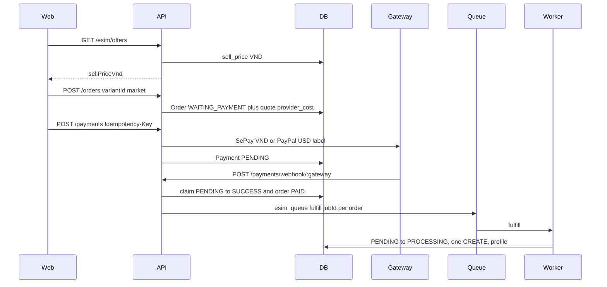
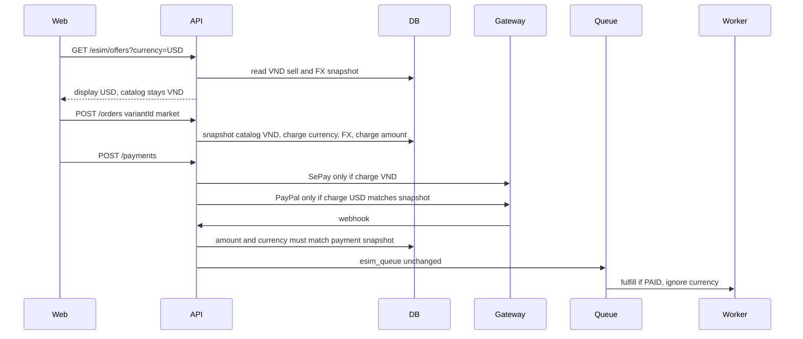
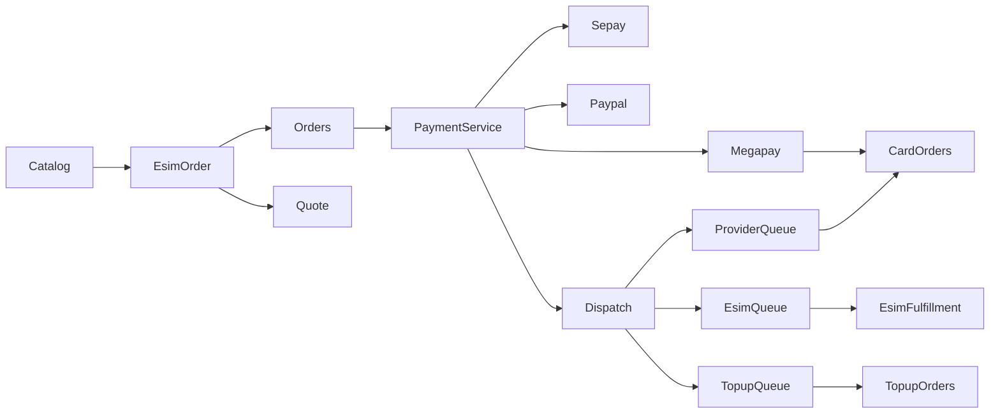

# Audit luồng eSIM trước Multi-Currency

Phạm vi: code và schema trong repo, cộng database local Docker `cardon` (Postgres `127.0.0.1:5433`, project `cardon-local-full`). Chỉ SELECT. Không sửa dòng, không migration, không đổi currency đơn cũ.

Phân loại:

- **[code]** đã đọc implementation.
- **[db]** đã đọc schema Prisma và đối chiếu local.
- **[cũ]** comment hoặc file phase mô tả luồng không còn khớp code đang chạy.
- **[chưa]** chưa xác minh được.

Production không được query. Mọi số đếm bên dưới là local, không phải production.

## Kết luận ngắn

Hệ thống đang bán eSIM theo giá VND. PayPal bị khóa USD trong adapter, SePay bị khóa VND trong payload cổng. `orders` và `payments` không có cột currency. Quote eSIM chỉ lưu giá vốn tại thời điểm tạo đơn, không có giá bán, currency, tỷ giá, TTL.

Local có một đơn PayPal admin-test: đơn lưu `103000.00`, payment lưu `1.00`, status `EXPIRED`. Hai số này không cùng đơn vị. Báo cáo lợi nhuận chung hardcode `currency: 'VND'` và cộng `orders.total_amount`.

Multi-Currency không gắn được an toàn bằng cách thêm một mã currency vào adapter. Cần snapshot trên đơn eSIM và payment eSIM, mặc định dữ liệu cũ là VND, và không đổi điều kiện cấp phát.

## A. Luồng eSIM thực tế

Không có bước quote trước checkout. Giá lấy lúc `POST /api/v1/orders`. Frontend không gửi số tiền.

| Bước | Module | API | Bảng | Trạng thái | Transaction / lỗi |
| --- | --- | --- | --- | --- | --- |
| 1. Catalog | `esim-public-catalog.service.ts`, `esim.controller.ts` | `GET /api/v1/esim/offers` | `product_variants.sell_price`, `esim_airalo_packages.sell_price_vnd` | Đọc. Không đổi đơn | Không ghi DB |
| 2. Pricing | `esim-order.service.ts` `getCustomerPrice`, `calculateCustomerPaid` | Trong `POST /orders` | `provider_product_mappings.provider_cost`, variant `sell_price` / `face_value` | Giá khách = giá variant. Phí làm tròn VND (`toFixed(0)`) | Chưa ghi |
| 3. Quote | `esim-order.service.ts` tạo `esimOrderQuote` trong transaction đơn | Không endpoint quote riêng | `esim_order_quotes`: `provider_cost`, `provider_product_code`, `provider_mode` | Tạo cùng đơn. Không TTL, không `expires_at` | Cùng transaction tạo đơn. Unique `order_item_id` |
| 4. Checkout | `apps/web/lib/esim-vn-checkout.ts` | `POST /orders` rồi `POST /payments` | — | Market `VN` + method SePay. Không gửi amount | Lỗi hiển thị ở client |
| 5. Order | `order.service.ts` tách lane eSIM rồi `EsimOrderService.create` | `POST /api/v1/orders` | `orders`, `order_items`, `financial_transactions` | Vào: variant ESIM active. Ra: `payment_status=WAITING_PAYMENT`, `fulfillment_status=PENDING` | Advisory lock user+variant. Tái sử dụng đơn chờ cùng variant. Cấm trộn eSIM với thẻ/nạp |
| 6. Payment | `payment.service.ts` `createPayment` | `POST /api/v1/payments` + header `Idempotency-Key` | `payments` | `PENDING`. `orders.payment_id` trỏ payment mới | SePay: `generateSepayPaymentCode`. Khác: `generatePaymentReference`. Unique `payment_reference`, `idempotency_key` |
| 7. Webhook | `payment.controller.ts`, `payment.service.ts` | `POST /api/v1/payments/webhook/:gateway` | `payments`, `orders` | SUCCESS chỉ từ `PENDING`. Expired + success muộn → manual review, không cấp phát | SePay ký HMAC trên raw body. Amount phải khớp `payments.amount` |
| 8. Queue | `fulfillment-dispatch.service.ts`, `esim-queue.producer.ts` | Không API | BullMQ `esim_queue` job `fulfill`, jobId `esim-fulfill-{orderId}`, `attempts: 1` | Sau commit PAID | Job id trùng thì nuốt lỗi “already exists” |
| 9. Worker | `esim.worker.ts` | — | — | `concurrency: 1` | Job lạ bị bỏ. Không gọi Airalo trong webhook |
| 10. Fulfillment | `esim-fulfillment.service.ts`, `esim-fulfillment.repository.ts` | — | `esim_provider_attempts`, `esim_profiles` | `PENDING → PROCESSING` bằng `updateMany`. Xong: `COMPLETED` hoặc `NEED_MANUAL_REVIEW` | Unique `open_guard`, `request_id`. Một CREATE cho một order item. Timeout mock/live không CREATE lại |
| 11. Customer | `esim-account.service.ts`, `esim.controller.ts` | `GET /api/v1/esim/profiles`, `GET /api/v1/esim/profiles/:orderId` | `orders`, `esim_profiles.install_secret_enc` | Chỉ đơn `PAID` của user | QR/LPA giải mã khi đọc. Không cột ICCID |
| 12. Admin | `esim-ops.controller.ts`, `esim-ops-dashboard.ts` | `POST /api/v1/admin/esim-ops/orders`, `.../reveal`, `.../recover` | Đọc đơn, payment, quote, attempt | Recover chỉ QUERY, không POST tạo mới | Dashboard suy currency: PayPal = USD, còn lại = VND |

Điều kiện cấp phát **[code]**: payment đã SUCCESS và đơn PAID, rồi worker claim `fulfillment_status = PENDING`. Currency không nằm trong điều kiện này.

`payment_queue` **[cũ]**: comment `payment-success-queue.rules.ts` nói queue này chỉ hết hạn và nói enqueue fulfillment “chưa implement”. Code hiện tại hết hạn bằng `ExpirationCronService` → `PaymentExpirationService`, và webhook gọi thẳng `FulfillmentDispatchService` sau commit. Không có `@Processor('payment_queue')`.

## B. Payment

### SePay **[code]**

Hai đường trong `sepay.provider.ts`:

- Payment Gateway: form `PURCHASE`, `currency: 'VND'`, `order_amount` làm tròn số nguyên (`sepay.pg.ts`).
- Chuyển khoản cũ: webhook đọc `content` / `code` để lấy payment reference, amount từ `transferAmount`.

Xác thực: `verifySepayWebhookAuth` với API key, webhook secret, IPN secret. HMAC dùng raw body, không serialize lại JSON.

Adapter không nhận currency khác VND ở payload cổng. Không suy ra SePay hỗ trợ currency khác.

### PayPal **[code] + [db]**

`paypal.provider.ts` từ chối mọi currency khác USD. Client gửi `currency_code: 'USD'`.

Khách INTL: `createPayment` lấy `orders.total_amount` (số VND, `toFixed(2)`) và gắn nhãn USD. Rule thị trường chỉ kiểm tra cặp INTL + USD + PAYPAL, không đổi số tiền sang USD.

Admin test: amount USD nằm trong `orders.client_trace.adminTestCharge`. Payment ghi số USD đó và không ghi đè `orders.total_amount`. Local: đơn `103000.00` / `sell_amount 103000.00` / `provider_cost 28284.00`, payment `1.00`, cả hai `EXPIRED`.

Capture phải khớp snapshot USD. EUR hoặc số catalog bị giữ `PENDING` (spec `paypal.checkout.spec.ts`).

### Amount

**[code]** Backend tính từ giá variant và phí. `startEsimVnCheckout` chỉ gửi `variantId`, `quantity: 1`, `paymentMethodCode`, `market: 'VN'`, `locale`.

### Idempotency và webhook

**[code]**

- `Idempotency-Key` unique. Cùng key trả payment cũ.
- `payment_reference` unique toàn cục.
- Webhook SUCCESS: `claimPendingStatus` chỉ `PENDING → SUCCESS` trong một transaction, rồi `markPaidInTransaction`.
- Webhook trùng cùng payment đã SUCCESS: PayPal gọi lại queue nếu chưa có cờ `fulfillmentQueued`; SePay trả duplicate và không dispatch lại.
- FAILED sau SUCCESS: claim thất bại vì không còn PENDING, coi là duplicate.
- SUCCESS sau FAILED: ném `ConflictException`, không tự đảo lại PAID.
- SUCCESS khi đã hết hạn: manual review, không cấp phát.
- Hai payment khác nhau cùng SUCCESS tuần tự: payment thứ hai rollback vì `assertPaymentTransition` thấy đơn đã PAID.

**[code] lỗ hổng race:** `updatePaymentStatus` không `updateMany` theo trạng thái cũ và không `SELECT FOR UPDATE`. Hai webhook của hai payment PENDING có thể cùng đọc `WAITING_PAYMENT` rồi cùng ghi PAID. Chưa thấy hai payment SUCCESS trên một đơn trong local.

### Đổi SePay sang PayPal

**[code]** Không đổi trên cùng đơn. `createPayment` từ chối PayPal nếu `orders.payment_gateway` không phải PAYPAL, và từ chối cổng khác nếu đơn đã là PAYPAL. Market gắn lúc tạo đơn. Đơn chờ cùng variant được tái sử dụng, nên khách không tạo đơn cổng kia cho cùng gói khi đơn SePay còn sống.

`createPayment` không kiểm tra lại market eSIM. Đơn eSIM SePay vẫn có thể nhận `gateway: MEGAPAY` nếu client gửi tay, rồi đi vào failover MegaPay → SePay của luồng bán lẻ. Storefront không làm vậy.

### Hai lần cấp phát

**[code] + [db]** Job id ổn định. `claimFirstCreate` chỉ một worker đưa PENDING → PROCESSING. `esim_provider_attempts.open_guard` unique (local index `esim_provider_attempts_open_guard_key`). `request_id` unique. Profile unique theo `order_item_id`. Lần fulfill sau thấy CREATE mở hoặc profile thì không POST tạo mới.

Admin test không được enqueue (`isPersistedAdminTest`).

Timeout Airalo: không CREATE lần hai. Không có reference thì `NEED_MANUAL_REVIEW`. Có reference và còn PROCESSING thì cron 5 phút enqueue `query_open`. Job query `attempts: 1`, `removeOnComplete`.

Worker chết giữa chừng: BullMQ không retry fulfill (`attempts: 1`). Phục hồi dựa vào open guard và cron query, không dựa vào currency.

## C. Database

### Schema **[code]**

| Bảng | Tiền | Currency | Ghi chú |
| --- | --- | --- | --- |
| `orders` | `total_amount`, `face_value`, `sell_amount`, `discount_amount`, `payment_fee_*`, `customer_paid`, `provider_cost`, `profit` Decimal(18,2) | Không có cột | `payment_id` unique. Unique `(agent_id, agent_request_id)` |
| `order_items` | `unit_price`, `discount`, `total_amount` | Không | Một quote, nhiều attempt, một profile |
| `payments` | `amount` Decimal(18,2) | Không có cột | Unique reference và idempotency key |
| `esim_order_quotes` | `provider_cost` | Không | Không giá bán, không TTL |
| `esim_provider_attempts` | Không tiền | Không | `request_id`, `open_guard` unique |
| `esim_profiles` | Không | Không | `install_secret_enc`. Không cột ICCID |
| `esim_airalo_packages` | `cost_amount` (18,4), `cost_vnd`, `sell_price_vnd`, `usd_vnd_rate` | `cost_currency` VarChar(8) | Giá bán lưu VND |
| `provider_product_mappings` | `provider_cost` Decimal(18,2) | Không | Dùng cho cả thẻ và eSIM |
| `provider_transactions` | `face_value`, `provider_cost` | Không | Thẻ / nạp. `request_id` unique |
| `refund_requests` / `refund_attempts` | amount | Enum `VND \| USD` | Comment schema: Payment không có currency; PayPal = USD, còn lại = VND |

Enum đơn: `WAITING_PAYMENT`, `PAID`, `FAILED`, `EXPIRED`, `REFUNDED`. Fulfillment: `PENDING`, `PROCESSING`, `COMPLETED`, `FAILED`, `WAITING_ADMIN_RETRY`, `NEED_MANUAL_REVIEW`. Payment: `PENDING`, `SUCCESS`, `FAILED`, `EXPIRED`. Gateway: `MEGAPAY`, `SEPAY`, `PAYPAL`.

### Local **[db]**

- `payments` và `orders`: 0 cột tên chứa `curr`.
- Đơn chưa xóa: MEGAPAY 58, SEPAY 28, PAYPAL 1.
- Payment: MEGAPAY EXPIRED 36 / SUCCESS 22; SEPAY EXPIRED 20 / SUCCESS 8; PAYPAL EXPIRED 1, amount `1.00`.
- Quote 29, profile 4, attempt 20. Cột quote đúng 7 field ở trên.
- Gói Airalo 2098, `cost_currency` toàn `VND`, `cost_amount = cost_vnd` toàn bộ, `usd_vnd_rate` toàn `26000.0000`. Giá bán 26000.00–4734000.00.
- `refund_requests`: 0 dòng.

Migration đã có trong repo, không chạy thêm trong audit: `20261009160000_esim_phase_a_mock`, `20261016150000_paypal_gateway_and_airalo`, `20261023100000_esim_airalo_catalogue_lifecycle`, `20261027160000_refund_request_attempt`, `20250618140000_payment_idempotency_key`, `20250623120000_phase_6o18_payment_fee_snapshot`.

### Tương thích dữ liệu cũ

Đơn và payment cũ không mang currency. Gán PayPal = USD chỉ vì tên cổng sẽ gán nhầm đơn admin-test nếu đọc `orders.total_amount` (103000) thay vì `payments.amount` (1.00). Backfill an toàn cho thẻ, nạp, MegaPay, SePay là `VND` và `charge_amount = total_amount`. Dòng PayPal phải đối chiếu payment amount với total đơn trước khi gán USD. Không được UPDATE trong phase này.

Quote cũ thiếu giá bán và tỷ giá. Không được bịa snapshot cho 29 quote local.

## D. Worker

**[code]** Queue liên quan:

| Queue | Việc | eSIM |
| --- | --- | --- |
| `esim_queue` | `fulfill`, `query_open` | Có. Worker riêng, concurrency 1 |
| `provider_queue` | Mua thẻ | Dispatch từ chối đơn thuần eSIM |
| `topup_queue` | Nạp cước / data | Không nhận đơn thuần eSIM |
| `payment_queue` | Tên có trong monitor | Không thấy processor. Hết hạn là cron |

Retry thẻ dùng `PROVIDER_QUEUE_MAX_ATTEMPTS` và `checkTransaction`. eSIM không dùng policy đó. Một CREATE. Lỗi provider → `NEED_MANUAL_REVIEW`, không refund tự động.

PAID + fulfillment thất bại: đơn vẫn PAID. Không cấp phát lại bằng CREATE mới nếu guard còn. Admin recover chỉ query.

Restart: job fulfill không tự retry. Cron query chỉ khi LIVE, PROCESSING, còn open guard, đã có `provider_reference`, chưa có profile, chưa có QUERY `SENT`.

## E. Admin và báo cáo

**[code]**

- Danh sách đơn admin: lọc `paymentStatus`, `fulfillmentStatus`, ngày. Không có lọc gateway trong `AdminOrderQueryDto`.
- Chi tiết đơn map gateway, phí, amount. Không có currency trên payment.
- eSIM ops dashboard tách tiền theo cổng bằng suy đoán PayPal = USD. Đó là quy ước, không phải cột DB.
- `ProfitService` / `finance.repository.calculateProfit`: cộng `total_amount` và `provider_cost` của mọi đơn PAID + COMPLETED (trừ admin test), trả `currency: 'VND'`. Không group theo cổng.
- Phí cổng: snapshot `payment_fee_amount` trên đơn, cùng kiểu Decimal, không currency.
- Refund và đối soát payment tồn tại (`RefundRequest`, `admin/finance` reconcile). Local chưa có refund. Đối soát cộng amount không currency.

**[db]** Local chưa có đơn PayPal PAID nên báo cáo lợi nhuận chưa bị cộng `1.00` với `103000`. Rủi ro nằm ở code, chưa thành hiện tượng trên local.

## F. Ranh giới thẻ, nạp, MegaPay, ví đại lý

Dùng chung và sẽ vỡ nếu sửa amount/currency tại chỗ:

- `PaymentService.createPayment` và webhook. Thẻ MegaPay và failover MegaPay → SePay dùng cùng hàm, amount = `orders.total_amount`.
- `orders` / `payments` / `financial_transactions`.
- `FulfillmentDispatchService` phân nhánh sau PAID. Đổi điều kiện PAID sẽ chạm cả ba sản phẩm.
- `NotificationService.notifyPaymentSuccess`.
- `ProfitService` và các SUM tài chính không currency.
- `provider_product_mappings.provider_cost` không currency, dùng cho thẻ và eSIM.

Tách sẵn, không được trộn:

- `esim_queue` với `provider_queue` và `topup_queue`.
- Airalo không đi `ProviderInterface.buyCard` / `topup`.
- Ví đại lý: webhook nạp (`agent deposit`) xử lý trước webhook đơn trong `payment.controller.ts`. Ledger HOLD không nằm trên đơn eSIM.
- Rule market eSIM từ chối `homeService` khác `ESIM`.

Mọi thay đổi sau này trên file dùng chung phải có test regression: tạo đơn thẻ MegaPay, nạp `topup_queue`, failover MegaPay → SePay, webhook nạp đại lý, và một đơn eSIM SePay vẫn VND.

## G. Sơ đồ

### Hiện tại

### Multi-Currency đề xuất

Không triển khai trong audit này.

### Phụ thuộc module

`PaymentService` và bảng `orders` / `payments` là điểm dùng chung. Queue eSIM đã tách.

## H. Vấn đề

| Vấn đề | Mức | Cách xử lý đề xuất, chưa làm |
| --- | --- | --- |
| Không có currency trên order và payment | Cao | Thêm cột, default VND. Không suy currency từ tên cổng |
| PayPal khách gửi số VND dưới nhãn USD | Cao | Chỉ gửi USD đã snapshot. Từ chối nếu amount bằng số catalog VND |
| Admin test: đơn 103000 và payment 1.00 | Cao | Giữ nguyên dòng cũ. Báo cáo không cộng hai số. Snapshot mới tách catalog và charge |
| Quote không có giá bán, currency, tỷ giá, TTL | Cao | Cột mới nullable. Quote cũ để null |
| Profit hardcode VND và cộng mọi `total_amount` | Cao | Tách theo currency. Không đưa USD vào tổng VND |
| Race hai payment PENDING | Trung bình | `UPDATE orders SET PAID WHERE payment_status = WAITING_PAYMENT`. Cấm payment PENDING thứ hai |
| `createPayment` không khóa lại market eSIM | Trung bình | Nếu đơn eSIM, chỉ đúng gateway đã gắn lúc tạo đơn |
| Comment `payment-success-queue.rules.ts` lệch code | Thấp | Sửa comment khi đụng file. Không dùng file đó làm đặc tả |
| ICCID không có cột | Thấp | Không chặn Multi-Currency. Không giải mã profile trong audit |
| Gói local `cost_currency=VND` và rate 26000 phẳng | Chưa phải FX sống | Không dùng rate local làm tỷ giá bán |

## Chưa xác minh

| Nội dung | Vì sao | Rủi ro nếu đoán sai | Cách xác minh sau |
| --- | --- | --- | --- |
| Production có đơn PayPal khách với amount bằng số VND | Chỉ query local | Đổi currency hàng loạt sẽ gán sai doanh thu | SELECT production: PayPal payment amount so với order total, không UPDATE |
| Airalo bán sỉ USD trên môi trường live | Local 2098 gói đã quy VND, rate 26000 | Snapshot giá vốn sai đơn vị | Đọc một package live `net_price` và currency Airalo, không ghi đè catalog |
| SePay hoặc PayPal có nhận currency khác trong hợp đồng | Code chỉ gửi VND và USD | Bật currency lạ sẽ bị cổng từ chối lúc thu tiền | Hỏi cấu hình merchant. Không suy từ tham số hàm |
| Email có chữ “đ” hoặc “USD” | Grep module notification không thấy chuỗi currency | Email khách sai đơn vị | Đọc template lúc làm snapshot |
| Job thực sự trong `payment_queue` | Không có processor | Tưởng webhook đi qua queue đó | Redis `LLEN` lúc triển khai, read-only |
| ICCID nằm trong ciphertext | Không giải mã | Tưởng có cột để lọc | Không cần cho currency |

## 2B. Đề xuất kiến trúc

Chỉ áp dụng cho eSIM. Thẻ game, thẻ điện thoại, nạp cước, MegaPay và ví đại lý giữ VND và giữ queue hiện tại.

### Nguyên tắc

1. Catalog gốc vẫn VND (`sell_price_vnd`, variant `sell_price`).
2. Đơn eSIM snapshot đủ bốn thứ: giá vốn, giá bán catalog VND, currency thu, số tiền thu, tỷ giá và thời điểm tỷ giá.
3. SePay chỉ khi currency thu là VND và amount là số nguyên VND khớp snapshot.
4. PayPal chỉ khi currency thu là USD và amount khớp snapshot USD. Không gửi `total_amount` VND sang PayPal.
5. Webhook so amount và currency với payment snapshot. Lệch thì không PAID.
6. Worker cấp phát không đọc currency. Điều kiện vẫn là PAID + claim PENDING + một CREATE.
7. Báo cáo không cộng khác currency. Dòng cũ backfill VND, trừ payment PayPal phải rà tay.
8. Không đổi 29 quote cũ và không đổi đơn `103000` / payment `1.00`.

### Schema đề xuất, chưa viết migration

`orders` thêm, default cho dòng cũ:

- `catalog_currency CHAR(3) NOT NULL DEFAULT 'VND'`
- `charge_currency CHAR(3) NOT NULL DEFAULT 'VND'`
- `charge_amount DECIMAL(18,2) NULL` — backfill bằng `total_amount` nơi cổng không phải PAYPAL
- `fx_rate DECIMAL(18,6) NULL`
- `fx_as_of TIMESTAMPTZ NULL`

`payments` thêm:

- `currency CHAR(3) NOT NULL DEFAULT 'VND'`
- Không backfill PayPal thành USD hàng loạt. Dòng local `1.00` cần phân loại thủ công trong plan triển khai, không trong audit.

`esim_order_quotes` thêm nullable: `sell_amount_vnd`, `charge_currency`, `charge_amount`, `fx_rate`, `fx_as_of`, `expires_at`. Null nghĩa là quote cũ không có snapshot. Không thêm TTL bắt buộc cho đơn đang chờ.

Không thêm cột vào `esim_profiles`, `esim_provider_attempts`, `provider_transactions`, ledger đại lý.

### Migration plan

1. Thêm cột nullable hoặc default VND. Không rewrite amount.
2. Backfill `charge_currency = 'VND'` và `charge_amount = total_amount` cho MEGAPAY và SEPAY.
3. PayPal: report riêng, không UPDATE cho đến khi đối chiếu từng payment.
4. Deploy code đọc cột mới nhưng vẫn fallback VND nếu null.
5. Bật ghi snapshot cho đơn eSIM mới.
6. Sau đó mới chặn PayPal khi amount không phải USD snapshot.
7. Sửa profit thành group theo currency trong cùng release với bước 6.
8. Test regression thẻ, nạp, MegaPay failover, webhook ví đại lý trước khi bật chặn.

### API

Giữ `POST /orders` và `POST /payments`. Thêm field trả về `catalogCurrency`, `chargeCurrency`, `chargeAmount`, `fxRate`. Không nhận amount từ client. `GET /esim/offers` có thể nhận currency hiển thị sau khi snapshot FX có nguồn chính thức. Local rate 26000 không phải nguồn đó.
