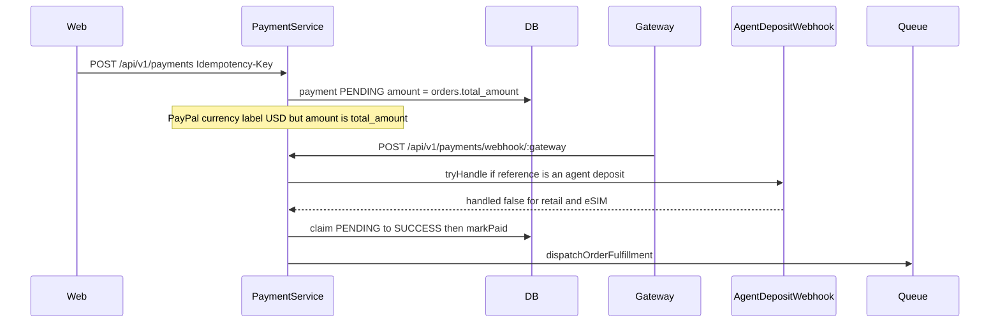

# Phase 2A — Payment và IPN preflight

Trạng thái: chỉ đọc code và tài liệu. Không sửa source, schema, migration, database, credential hay Production. Không bắt đầu Phase 2B.

Nhãn:

| Nhãn | Nghĩa |
| --- | --- |
| Đã xác minh trong code | Đọc implementation hiện tại |
| Tài liệu nhà cung cấp | Đọc `developer.sepay.vn` ở vòng thiết kế 2026-11-06 |
| Thiết kế đề xuất | Chưa có trong code |
| Chưa xác minh | Thiếu bằng chứng merchant hoặc tài liệu |

Phase 1 đã thêm cột nullable `orders.catalog_*`, `orders.charge_*`, `payments.currency`, `payments.product_lane`, `payments.fx_rate_id` và hai bảng FX rỗng. Các cột payment chưa được `PaymentService` ghi.

## 1. Luồng payment hiện tại

Đã xác minh trong code. eSIM, thẻ và nạp đi chung `PaymentService`. Không có nhánh eSIM trước khi gán amount.

## 2. Entry point và file

Prefix API mặc định là `api/v1` (`src/main.ts`). Controller là `payments`.

| Cửa | File | Việc hiện tại |
| --- | --- | --- |
| `POST /api/v1/payments` | `payment.controller.ts`, `payment.service.ts` `createPayment` | Tạo payment. Bắt `Idempotency-Key` |
| `POST /api/v1/payments/orders/:orderId/sync` | `payment.service.ts` `syncFromGateway`, `syncPaypalPayment` | Query cổng rồi có thể PAID |
| `POST /api/v1/payments/webhook/:gateway` | `payment.controller.ts` `handleWebhook` | Đại lý trước, rồi payment đơn |
| PayPal return | `apps/web/app/checkout/paypal/return/PaypalReturnClient.tsx` | Gọi sync. Không tin query string |
| Tạo đơn eSIM | `esim-order.service.ts` | Ghi snapshot VND. Không tạo payment |
| Cấp phát | `fulfillment-dispatch.service.ts`, `esim-queue.producer.ts`, `esim.worker.ts` | Sau PAID |

Adapter: `providers/sepay/sepay.provider.ts`, `sepay.pg.ts`, `sepay.auth.ts`, `providers/paypal/paypal.provider.ts`, `paypal.client.ts`, `paypal.rules.ts`, `providers/megapay/megapay.provider.ts`.

`payments.currency`, `product_lane`, `fx_rate_id` có trên schema. `payment.create` trong `createPayment` không ghi ba cột đó. Chúng đang null trên mọi payment local sau Phase 1. Đã xác minh trong code và ở lần kiểm tra local Phase 1.

Idempotency: header bắt buộc. `payments.idempotency_key` unique. Cùng key trả payment cũ. `payments.payment_reference` unique. Đơn trỏ `orders.payment_id` sau khi insert. Không có khóa “một payment PENDING cho một order” trên đường khách. Đường admin-test PayPal có `SELECT … FOR UPDATE` và từ chối payment PENDING/SUCCESS thứ hai nếu amount khác.

## 3. Nơi cập nhật order sang PAID

Đã xác minh trong code. Tất cả nằm trong `payment.service.ts`, trừ hàm order:

| Hàm | Khi nào | Điều kiện trạng thái cũ |
| --- | --- | --- |
| `processSuccessWebhookAtomically` | Webhook SUCCESS và sync thành công | Claim payment `PENDING`, rồi `markPaidInTransaction` |
| `syncPaypalPayment` | PayPal return hoặc sync | Cùng hàm atomic sau capture khớp `payments.amount` |
| `approveManualReview` | Admin duyệt late payment | `markPaidAfterManualReviewInTransaction` |
| `OrderService.markPaidInTransaction` | Được gọi từ hai hàm trên | Đọc trạng thái rồi `update` không `WHERE payment_status = WAITING_PAYMENT` |
| `OrderService.markPaid` | Wrapper public | Cùng hàm, không thấy controller payment gọi trực tiếp |

`updatePaymentStatus` trong `order.repository.ts` là `update` theo id, không compare-and-swap.

Late success (`isWebhookPaymentExpired`) gọi `handleLateSuccessWebhook` và không PAID, không queue. Đã xác minh.

## 4. Nơi enqueue fulfillment

Đã xác minh trong code.

| Chỗ | Queue |
| --- | --- |
| Webhook SUCCESS, gateway không phải PayPal | `dispatchOrderFulfillment` ngay sau commit |
| PayPal SUCCESS | `queuePaypalFulfillmentIfNeeded`. Bỏ qua nếu `fulfillmentQueued` hoặc admin-test |
| `syncFromGateway` không PayPal, sau query SUCCESS | Dispatch cả khi claim trả duplicate |
| PayPal sync khi payment đã SUCCESS | `queuePaypalFulfillmentIfNeeded` |
| `approveManualReview` khi không duplicate | Dispatch `manual` |
| `FulfillmentDispatchService` | eSIM thuần → `esim_queue` job `esim-fulfill-{orderId}`, `attempts: 1`. Admin-test không enqueue |
| Worker | `esim.worker.ts`. Một CREATE nhờ `open_guard` |

Webhook SePay trùng trả `{ success: true }` và không dispatch lại. Job id eSIM nuốt job đã tồn tại.

Điểm lệch: sync không PayPal vẫn dispatch khi `duplicate === true` (`payment.service.ts` sau `processSuccessWebhookAtomically`). Cấp phát eSIM vẫn được job id và `open_guard` chặn CREATE thứ hai. Đây không phải giấy phép để gọi queue thêm.

## 5. Ranh giới phân nhánh eSIM

Thiết kế đề xuất. Chưa có trong code.

Ba cửa phải trả về trước nhánh retail nếu đơn là eSIM thuần:

1. `createPayment`, trước dòng gán `amount = orders.total_amount` và `currency = USD` khi gateway là PayPal.
2. `handleWebhook`, sau `AgentDepositWebhookService.tryHandle` và trước `paymentService.handleWebhook`, chỉ khi payload là IPN eSIM. IPN eSIM không được vào URL webhook cũ.
3. `syncFromGateway` và `syncPaypalPayment`, trước `markPaidInTransaction`.

Nhánh eSIM gọi settlement riêng: claim payment `PENDING → SUCCESS` và `UPDATE orders SET payment_status = PAID WHERE payment_status = WAITING_PAYMENT` trong một transaction. `count = 0` thì rollback. Không gọi `markPaidInTransaction`.

Không sửa:

- `POST /api/v1/payments/webhook/sepay`
- `verifySepayWebhookAuth` và HMAC `timestamp.rawBody`
- `AgentDepositWebhookService` và `AgentDepositService`
- Nhánh failover MegaPay → SePay (`preferLegacyQr: true`) trong `createPayment`
- `signSepayPgFields` của bán lẻ
- `esim.worker.ts`, `esim-queue.producer.ts`, điều kiện CREATE

Cột `product_lane = 'ESIM'` chỉ do nhánh eSIM ghi. Index `payments_one_open_esim` đã có từ Phase 1 và chưa ăn vào payment hiện tại vì `product_lane` đang null.

## 6. Hợp đồng SePay checkout và IPN

### Đang chạy

Đã xác minh trong code.

- Webhook đại lý và bán lẻ: `POST /api/v1/payments/webhook/sepay`.
- HMAC webhook: `X-SePay-Signature`, `X-SePay-Timestamp`, chuỗi `timestamp.rawBody`, SHA-256 hex, lệch quá 5 phút thì từ chối (`sepay.auth.ts`).
- Nếu cấu hình có `ipnSecretKey`, cùng hàm còn chấp nhận `X-Secret-Key`.
- Đại lý: `tryHandle` chỉ cộng ví khi reference khớp khoản nạp. Không khớp thì `handled: false` và payment đơn xử lý tiếp.
- Form Payment Gateway bán lẻ ký bằng `signSepayPgFields`. Thứ tự field bắt đầu `merchant`, `operation`, `payment_method`. Currency cứng `VND`.

### Tài liệu SePay

Tài liệu nhà cung cấp, trang form checkout và trang IPN:

- Form production `https://pay.sepay.vn/v1/checkout/init`. Chữ ký HMAC-SHA256, Base64, secret merchant.
- Thứ tự field tài liệu bắt đầu `order_amount`, `merchant`, `currency`. Khác signer bán lẻ.
- Tài liệu form nói `PURCHASE` chỉ VND.
- IPN `X-Secret-Key` khi Auth Type là `SECRET_KEY`. Trang không mô tả HMAC cho IPN.
- Merchant Secret và IPN Secret là hai key.
- `ORDER_PAID` kèm ví dụ `order_status = CAPTURED`, `transaction_status = APPROVED`, currency VND.
- Redirect success không phải bằng chứng.

### Đề xuất cho eSIM

Thiết kế đề xuất.

- Endpoint mới `POST /api/v1/payments/ipn/esim/sepay`. Không gọi service ví.
- Signer mới, không sửa `signSepayPgFields`. Thứ tự field theo tài liệu SePay. Sandbox phải mở được trang thanh toán trước khi dùng host production.
- Checkout amount và currency lấy từ `orders.charge_amount` và `orders.charge_currency`. Phase 1 ghi cả hai là VND và `charge_amount = customer_paid`.
- `order_invoice_number` là `payments.payment_reference` của payment eSIM, không dùng format reference nạp đại lý.
- Payment insert ghi `currency = VND`, `product_lane = ESIM`, `amount = charge_amount`, `fx_rate_id` null vì charge VND không quy đổi.
- PAID chỉ khi: secret `SECRET_KEY` đúng environment, `notification_type = ORDER_PAID`, `order_status = CAPTURED`, `transaction_status = APPROVED`, cả hai currency là VND, cả `order_amount` và `transaction_amount` khớp snapshot, invoice khớp reference, đơn còn `WAITING_PAYMENT` và chưa quá hạn.
- Provider transaction id lấy từ `order.id` hoặc `transaction.id` trong IPN. Cùng id là trùng.
- `TRANSACTION_VOID` khi chưa PAID thì FAILED, không queue. Khi đã PAID thì manual review, không CREATE mới.
- Không lưu `card_number`, `card_expiry`, `card_holder_name`, CVV.
- NAPAS và thẻ không có trong form Phase 2. Method đầu chỉ QR chuyển khoản trên gateway, và chỉ sandbox.
- Success URL chỉ được gọi sync đọc. Sync không PAID nếu chưa có IPN hoặc query đã xác minh. Phase 2B không coi redirect là bằng chứng.

Chưa xác minh: sandbox có chấp nhận thứ tự field của trang tài liệu hay không. Quyền NAPAS và Visa của merchant. Auth Type IPN khác `SECRET_KEY`. Field amount nào thắng nếu hai số IPN khác nhau. Thiết kế chọn không PAID khi chúng lệch nhau.

## 7. Hợp đồng PayPal USD

Đã xác minh trong code.

- Khách: `createPayment` gửi `orders.total_amount` với nhãn USD (`paypal.provider.ts` từ chối currency khác USD, `paypal.client.ts` gửi `currency_code: USD`).
- Admin-test: amount gửi đi và `payments.amount` là `clientTrace.adminTestCharge.amount`. `orders.total_amount` không đổi. Local vẫn là đơn `103000.00` và payment `1.00`.
- Capture phải khớp `payments.amount` và USD (`paypal.rules.ts`). EUR hoặc số lệch giữ PENDING.
- Return URL gọi sync. Sync capture rồi mới PAID.
- Webhook PayPal cũng vào `handleWebhook`.

Thiết kế đề xuất.

- Khách INTL chưa được gửi `total_amount` VND. Phase 2C chỉ tạo PayPal khi `charge_currency = USD` và `charge_amount` là số USD đã snapshot. Phase 1 chưa ghi charge USD. Vì vậy PayPal khách vẫn tắt cho đến khi có snapshot USD. Không bật trong 2B.
- Admin-test giữ nguyên: giá trị đơn là `total_amount` và snapshot catalog VND. Khoản thử là `clientTrace.adminTestCharge.amount` và `payments.amount`. Nhánh mới không được lấy `103000` làm số PayPal, và không được lấy `1.00` làm doanh thu catalog.
- Payment USD ghi `payments.currency = USD`, `product_lane = ESIM`, `amount = charge snapshot`, `fx_rate_id` từ đơn.
- Webhook và sync eSIM dùng settlement riêng. Cờ tắt checkout không chặn webhook của payment đã tạo.
- Retail không có PayPal. Không đổi adapter cho đơn không eSIM.

Chưa xác minh: merchant PayPal production đã được phép thu USD cho khách hay chưa. Không dùng credential thật trong preflight này.

## 8. State và concurrency

Đã xác minh lỗ hổng: hai payment khác nhau có thể cùng đọc `WAITING_PAYMENT` vì update đơn không compare-and-swap. Claim trên cùng một payment thì an toàn (`claimPendingStatus` chỉ `PENDING`).

Thiết kế đề xuất cho eSIM.

| Sự kiện | Transition |
| --- | --- |
| Tạo payment | Một dòng `PENDING` + `product_lane = ESIM`. Index chặn dòng mở thứ hai |
| IPN hoặc sync SUCCESS đúng snapshot, đơn `WAITING_PAYMENT`, chưa hết hạn | Payment `SUCCESS`, order `PAID`, một job `esim_queue` |
| Cùng payment SUCCESS lần nữa | Duplicate. Không PAID lần hai. Không CREATE lần hai |
| SUCCESS sai amount hoặc currency | Không claim |
| SUCCESS sau `expires_at` hoặc đơn `EXPIRED` | Manual review. Không queue |
| FAILED hoặc VOID khi còn `WAITING_PAYMENT` | Payment `FAILED`. Không queue |
| Payment khác báo SUCCESS sau khi đơn đã PAID | Update đơn `count = 0`, rollback claim payment đó |
| Queue lỗi sau khi đã PAID | Đơn stays PAID. Job id cho phép enqueue lại. Worker không CREATE nếu còn guard |
| Admin-test | Không enqueue, như hiện tại |

Khóa: `pg_advisory_xact_lock` theo order id trong transaction settlement, cộng unique index một payment eSIM `PENDING` hoặc `SUCCESS`. IPN và PayPal sync của hai đơn khác nhau không dùng chung lock. Cùng một đơn thì lock xếp hàng.

Retail giữ `markPaidInTransaction`. Race của thẻ không sửa trong Phase 2.

## 9. File dự kiến Phase 2B và 2C

Chưa sửa file nào ở đợt 2A. Danh sách dưới đây là đề xuất cho đợt sau.

### 2B — SePay eSIM sandbox, PayPal khách vẫn tắt

- Mới: module IPN eSIM, signer checkout eSIM, settlement `claimEsimPaid`.
- Sửa tối thiểu `payment.controller.ts` để thêm route IPN. Không sửa thân `webhook/:gateway`.
- Sửa tối thiểu `payment.service.ts` `createPayment`: nếu đơn eSIM thì return sang service eSIM trước failover và trước gán `total_amount`.
- Ghi `payments.currency`, `product_lane` cho payment eSIM VND.
- Test webhook đại lý, MegaPay failover, đơn thẻ, đơn nạp.

Không đụng `sepay.auth.ts`, `signSepayPgFields`, wallet, worker Airalo.

### 2C — PayPal USD theo snapshot

- Chỉ sau khi đơn eSIM có `charge_currency = USD` và `charge_amount` USD. Phase 1 chưa có đường ghi đó.
- Sửa nhánh tạo PayPal eSIM để amount lấy từ snapshot, không lấy `total_amount`.
- Admin-test vẫn dùng `adminTestCharge.amount`.
- Sync và webhook PayPal eSIM đi `claimEsimPaid`.
- Không bật production. Không bật Visa hay NAPAS.

## 10. Test dự kiến

Chưa viết ở đợt này.

| Nhóm | Kỳ vọng |
| --- | --- |
| Tạo payment eSIM VND | `payments.amount` và `currency` bằng snapshot. Không gọi PayPal |
| Idempotency-Key trùng | Một payment, một lần gọi cổng |
| Key thứ hai khi đang PENDING | 409 |
| IPN đúng | Một lần PAID, một job |
| IPN lặp | Không PAID lần hai, không CREATE lần hai |
| Sai amount hoặc currency | Không PAID |
| Redirect success không có IPN | Không PAID |
| IPN sau hạn | Manual review, không queue |
| Hai IPN hai payment | Một PAID |
| Admin-test `1.00` và đơn `103000` | PayPal nhận `1.00`. `total_amount` vẫn `103000`. Không enqueue |
| Webhook `POST /payments/webhook/sepay` nạp đại lý | Vẫn cộng ví một lần. HMAC cũ |
| MegaPay lỗi, failover retail | Vẫn SePay QR cũ. eSIM không đi nhánh này |
| Thẻ game, thẻ điện thoại | `provider_queue` |
| Nạp cước | `topup_queue` |
| PayPal khách khi chưa có snapshot USD | Không tạo payment |

## 11. Chưa xác minh

- Sandbox SePay có nhận đúng thứ tự chữ ký trên trang tài liệu hay không.
- Merchant Cardon đã được NAPAS hoặc Visa chưa. Mặc định không bật.
- Auth Type IPN ngoài `SECRET_KEY`.
- `order_amount` và `transaction_amount` lệch nhau thì SePay coi số nào là chuẩn. Ta không PAID.
- PayPal production có được thu USD cho khách eSIM chưa.
- Production còn payment PayPal nào khác admin-test local hay không. Preflight này không query production.
- Query API SePay có đủ field để dùng làm bằng chứng song song với IPN hay không. Chưa đọc trang query trong đợt này. Redirect vẫn không phải bằng chứng.

## 12. Rủi ro và điều kiện go-live

| Rủi ro | Mức | Cách chặn |
| --- | --- | --- |
| eSIM vẫn đi `createPayment` chung và gửi VND dưới nhãn USD | Cao | 2B rẽ trước dòng amount. 2C mới mở PayPal khách |
| IPN eSIM đi vào webhook đại lý | Cao | URL riêng. Reference không trùng format nạp |
| Sửa `signSepayPgFields` làm hỏng checkout bán lẻ | Cao | Signer eSIM là file mới |
| Hai payment cùng PAID | Trung bình | Index lane eSIM và update có điều kiện |
| Admin-test `1.00` bị đọc thành giá đơn hoặc `103000` bị gửi sang PayPal | Cao | Hai field tách như mục 7 |
| Bật Visa hoặc production khi chưa có xác nhận | Cao | 2B và 2C không bật |

Go-live production không thuộc 2B hay 2C. Cần thêm: IPN sandbox một giao dịch đúng và một giao dịch lệch amount, regression bán lẻ và webhook đại lý xanh, signer mới được sandbox chấp nhận, và chủ sản phẩm xác nhận merchant. Trước đó gateway production của eSIM ở trạng thái tắt.

Dừng để nghiệm thu Phase 2A. Không bắt đầu Phase 2B.
