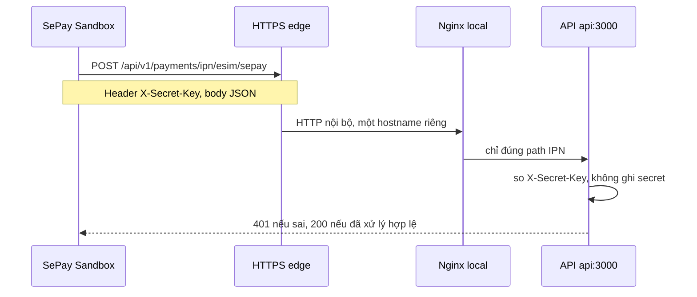

# Phase 2B.3A — Khả năng expose API local cho SePay IPN

Ngày: 2026-11-06. Chỉ audit và đề xuất. Không sửa source, Compose, DNS, firewall, tunnel, `APP_PUBLIC_URL`, database hay volume. Không gọi SePay và không tạo giao dịch.

Kết luận: API local có thể được đưa ra một hostname HTTPS riêng mà không đụng website `cardon.vn`. Phương án phù hợp cho đợt Sandbox là Cloudflare Tunnel có tên cố định, chỉ chuyển đúng một path IPN. Chưa triển khai. Credential Sandbox và hostname public vẫn thiếu.

## 1. Kiến trúc hiện tại

Project `cardon-local-full`. Mọi container nằm trên network `cardon-local-full_cardon-local-full`.

| Thành phần | Địa chỉ trong Docker | Port máy host |
| --- | --- | --- |
| API `cardon-local-full-api` | `api:3000` | không publish. Image `sha256:b541448d1551063fd0ad4749de9d3056c14e681b8f492b9b63398543c72d0f0c` |
| Web | `web:3001` | không publish |
| Partner | `partner:3002` | không publish |
| Admin | `admin:3003` | không publish |
| Worker | không nhận HTTP từ nginx | không publish |
| Redis | `redis:6379` | không publish |
| Postgres | `postgres:5432` | `0.0.0.0:5433` và `[::]:5433` |
| Nginx `cardon-local-full-nginx` | listen 80 | `0.0.0.0:80` và `[::]:80` |

Nginx local mount `infra/nginx/conf.d.local`, không mount cấu hình production `infra/nginx/conf.d`. File local chỉ có HTTP, không có TLS. `server_name` là `localhost`, `partner.localhost`, `admin.localhost`.

Máy host gọi API qua `http://localhost/api/...`. Nginx chuyển `location /api/` sang `http://cardon_api/api/`. Website đi `location /` sang container web. API và web là hai container riêng, nên một vhost mới có thể trỏ tới API mà không đưa container web ra Internet.

Route IPN đã có trong process local: `POST /api/v1/payments/ipn/esim/sepay`. Handler là `@Public()`, đối chiếu `X-Secret-Key`, và không ghi secret. Khi Sandbox đang tắt, request thiếu hoặc sai secret trả 401.

`APP_PUBLIC_URL` chỉ được code dùng cho URL trình duyệt success, error và cancel. URL IPN không lấy từ biến này. SePay nhận URL IPN từ cấu hình merchant. Vì vậy việc SePay gọi IPN không đòi hỏi đổi `APP_PUBLIC_URL` trong đợt này.

Postgres đang publish ra mọi interface cổng 5433. Redis thì không. Đây là trạng thái local hiện có. Phương án expose bên dưới không được publish thêm Postgres hay Redis. Trước khi mở bất kỳ đường public nào, nên siết Postgres về `127.0.0.1`. Việc siết đó chưa làm trong audit này.

## 2. Domain hiện có

DNS được đọc, không bị sửa.

| Hostname | Trạng thái |
| --- | --- |
| `cardon.vn`, `www.cardon.vn` | có bản ghi A. HTTPS trang chủ trả 200. IPN eSIM trên host này trả 404. Đây không phải API local |
| `admin.cardon.vn`, `partner.cardon.vn` | có bản ghi A. Cấu hình nginx production trong repo phục vụ admin và partner |
| `ipn-sandbox.cardon.vn`, `pay-sandbox.cardon.vn` | chưa có bản ghi |

Repo đã có nginx production cho `cardon.vn` với TLS và `location /api/` chuyển toàn bộ API, cộng alias webhook đại lý `/api/v1/payments/webhooks/sepay`. File đó không được nginx local load. Không dùng `cardon.vn` làm callback của API local.

Subdomain đề xuất, chưa tạo: `ipn-sandbox.cardon.vn`. Chỉ dùng cho IPN eSIM Sandbox. Không dùng `admin` hay `partner`.

## 3. Luồng đề xuất

Edge là TLS termination. Nginx local chỉ có một `location` bằng đúng path IPN. Các path admin, website, partner và webhook đại lý không đi qua hostname này.

## 4. Hai phương án

### Phương án 1 — Subdomain, reverse proxy và TLS trên máy này

Tạo `ipn-sandbox.cardon.vn`, chứng chỉ TLS, và một server nginx chỉ proxy path IPN tới `api:3000`. Máy phải có IP public, cổng 443 mở, và DNS trỏ đúng máy đang chạy stack local.

| Tiêu chí | Đánh giá |
| --- | --- |
| Độ ổn định URL | Cao nếu DNS và IP máy cố định |
| Bảo mật | Tốt khi nginx chỉ mở một path. Kém nếu publish nguyên cổng 80 hiện tại, vì `location /api/` đang mở toàn bộ API |
| Kiểm thử IPN | Được, sau khi DNS và TLS sống |
| Công sức | Cao với máy dev: IP public, firewall, chứng chỉ, giữ máy luôn bật |
| Website hiện tại | Không ảnh hưởng nếu hostname và vhost tách khỏi `cardon.vn` |

Chưa có IP public nào được xác nhận cho máy local. Mở firewall nằm ngoài phạm vi audit này.

### Phương án 2 — Cloudflare Tunnel

`cloudflared` trên máy local mở kết nối ra Cloudflare. Không cần mở cổng inbound. Hostname đề xuất vẫn là `ipn-sandbox.cardon.vn`, trỏ vào tunnel, origin là nginx local với vhost chỉ có path IPN.

| Tiêu chí | Đánh giá |
| --- | --- |
| Độ ổn định URL | Cao với named tunnel. URL tạm dạng trycloudflare thì đổi mỗi lần chạy, không dùng cho SePay |
| Bảo mật | Không mở cổng máy. Có thể xóa tunnel để thu hồi URL. Vẫn phải giới hạn origin ở một path |
| Kiểm thử IPN | Phù hợp Sandbox ngắn hạn |
| Công sức | Thấp hơn phương án 1. `cloudflared` hiện chưa có trên máy |
| Website hiện tại | Không đụng `cardon.vn` nếu hostname tunnel là subdomain mới |

Repo production đã tin dải IP Cloudflare trong `infra/nginx/conf.d/00-cloudflare-real-ip.conf`. Nginx local chưa load file đó. Tunnel không bắt buộc phải dùng file đó nếu origin chỉ nghe từ process tunnel trên localhost.

## 5. Rủi ro và cách chặn

| Rủi ro | Cách chặn |
| --- | --- |
| Mở toàn bộ `/api/` ra Internet | Vhost public chỉ có `location = /api/v1/payments/ipn/esim/sepay`. Không proxy `/`, `/api/v1/admin` hay webhook đại lý |
| Secret bị log | Giữ handler hiện tại: log chỉ có mã lý do và invoice. Nginx access log hiện không ghi header `X-Secret-Key` |
| Sai hoặc thiếu secret | API trả 401. Sandbox đang tắt cũng trả 401 |
| Postgres hoặc Redis lộ theo đường expose mới | Không publish hai dịch vụ này trong tunnel hay vhost. Redis hiện đã không publish. Postgres đang lộ cổng 5433 trên mọi interface; siết riêng, không nằm trong đường IPN |
| Rate limit | `ThrottlerGuard` toàn API: 100 request / 60 giây. IPN không bị `SkipThrottle`. Một IPN Sandbox nằm trong ngưỡng này. Vượt ngưỡng thì 429 và SePay gửi lại |
| Không thu hồi được sau kiểm thử | Tắt `ESIM_SEPAY_SANDBOX_ENABLED`, xóa tunnel hoặc bản ghi DNS, đổi IPN secret. Ba việc này độc lập |
| Nhầm webhook đại lý | URL đăng ký với SePay phải là path `/ipn/esim/sepay`, không phải `/webhook/sepay` |
| Dùng `cardon.vn` | Không dùng. Host đó là website đang sống và API production chưa có route này |

`X-Secret-Key` đã được kiểm tra trong API. HTTPS phải nằm ở edge. API local phía sau edge vẫn có thể nói HTTP trên network Docker.

## 6. Phương án được khuyến nghị

Dùng **Cloudflare Tunnel named** với hostname mới `ipn-sandbox.cardon.vn`, origin là một vhost nginx chỉ chuyển `POST /api/v1/payments/ipn/esim/sepay` tới `api:3000`.

Lý do: máy local không có TLS và không có cổng public đã được duyệt. Tunnel không mở firewall, không đổi website `cardon.vn`, và xóa được sau nghiệm thu. Subdomain cộng TLS trên chính máy này để dành cho khi IPN chạy trên server cố định, không dùng cho đợt Sandbox trên máy dev này.

Không đăng ký IPN vào `https://cardon.vn`. Không đổi `APP_PUBLIC_URL` chỉ để SePay gọi IPN.

## 7. Điều kiện còn thiếu

1. Credential Sandbox vẫn chưa có. Checkout eSIM vẫn tắt.
2. Chưa có bản ghi DNS `ipn-sandbox.cardon.vn`.
3. `cloudflared` chưa được cài. Tunnel chưa tạo.
4. Chưa có vhost nginx chỉ một path. Cấu hình local hiện proxy cả `/api/`.
5. Chưa siết Postgres khỏi `0.0.0.0:5433`.
6. Chưa đăng ký URL IPN trong SePay Sandbox.
7. Chưa chứng minh SePay thực sự gọi tới được, vì đường public chưa tồn tại.

Phase 2B.3A dừng tại đề xuất. Không triển khai expose.
