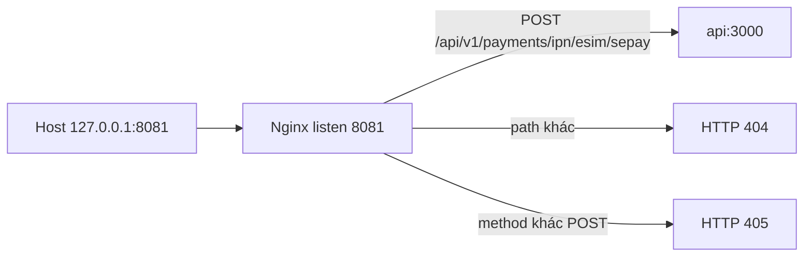

# Phase 2B.4C — Nginx listener riêng cho eSIM IPN

Ngày: 2026-11-06. Đã thêm listener HTTP chỉ cho `POST /api/v1/payments/ipn/esim/sepay`, publish trên host tại `127.0.0.1:8081`. Chưa nối Cloudflare Tunnel, chưa bật SePay sandbox, chưa thực hiện giao dịch.

## Kết luận

**PASS.** Listener loopback chỉ proxy đúng một POST tới API. Path khác trả 404 từ Nginx. Method khác POST trả 405 từ Nginx. Website cổng 80 và `https://cardon.vn` vẫn hoạt động. API, worker, PostgreSQL và Redis không bị recreate.

## 1. Trước khi đổi

Stack đang chạy là Compose `cardon-local-full`.

| Mục | Trạng thái ban đầu |
| --- | --- |
| Nginx | container `cardon-local-full-nginx`, image `nginx:1.27-alpine`, network `cardon-local-full` |
| API | container `cardon-local-full-api`, service name `api`, cổng nội bộ 3000 |
| Upstream Nginx | `cardon_api` trỏ `api:3000` |
| Publish | chỉ `80/tcp` ra `0.0.0.0:80` và `[::]:80` |
| Cổng 8081 | không có listener |
| Website local | `infra/nginx/conf.d.local/00-local-production.conf` proxy cả `location /api/` |
| Virtual host `cardon.vn` | nằm ở `infra/nginx/conf.d/`, không được mount vào Nginx local |
| Health | Nginx, API, worker, PostgreSQL, Redis đều healthy |
| `GET http://127.0.0.1/health` | HTTP 200 |
| `POST http://127.0.0.1/api/v1/payments/webhook/sepay` | HTTP 401 |

## 2. File đã đổi

- Tạo `infra/nginx/conf.d.local/10-esim-ipn-sandbox.conf`.
- `docker-compose.local-full.yml`: thêm publish `127.0.0.1:8081:8081`. Dòng `80:80` giữ nguyên.

Không sửa source API, file cấu hình `cardon.vn`, tunnel, DNS, `APP_PUBLIC_URL`, hay `ESIM_SEPAY_SANDBOX_ENABLED`.

Chỉ recreate container Nginx. API tạo lúc `2026-11-06T10:58:32Z`, worker `2026-11-05T13:59:09Z`, PostgreSQL `2026-11-06T11:15:31Z`, Redis `2026-10-09T14:26:47Z` đều không đổi. Volume `cardon-local-full_cardon_local_full_postgres` còn nguyên.

## 3. Routing thực tế

Service name thật trong Compose là `api`, không phải `cardon-api`. Nginx dùng upstream sẵn có `cardon_api`.

Listener này không dùng `location /api/`, không proxy website, và không redirect.

## 4. Port binding

`docker port cardon-local-full-nginx`:

| Container | Host |
| --- | --- |
| `80/tcp` | `0.0.0.0:80` và `[::]:80` (giữ như cũ) |
| `8081/tcp` | `127.0.0.1:8081` |

Không có `0.0.0.0:8081` và không có `[::]:8081`. Kết nối TCP tới `192.168.50.15:8081` đóng. `127.0.0.1:8081` mở.

Nginx trong container phải listen trên cổng 8081 của interface container để Docker forward được. Publish ra host chỉ là loopback.

## 5. Test A–F

| Test | Request | Kết quả |
| --- | --- | --- |
| A, không secret | `POST /api/v1/payments/ipn/esim/sepay` | HTTP 401, body API `Invalid signature` |
| A, secret giả | cùng path, `Content-Type: application/json` | HTTP 401, cùng body API |
| B | `POST /api/v1/payments/webhook/sepay` | HTTP 404, trang Nginx |
| C | `GET /` | HTTP 404, trang Nginx |
| D | `GET /api/v1/payments/ipn/esim/sepay` | HTTP 405, trang Nginx |
| E | body JSON hợp lệ và body JSON cụt | xem bên dưới |
| F | loopback, LAN, cổng 80, `cardon.vn` | xem mục 4 và mục 6 |

Test E:

- Body hợp lệ dài 28 byte qua listener và gọi thẳng `api:3000` đều trả HTTP 401, body dài 81 byte, cùng message `Invalid signature`.
- Body `{"probe":` dài 9 byte qua cả hai đường đều trả HTTP 400, message `Unexpected end of JSON input`. Parser của API nhận đúng byte cụt, Nginx không sửa thành JSON hợp lệ.
- Access log riêng ghi `cl=28` hoặc `cl=9`, `ct="application/json"`, và `secret_present=1` khi có header, `secret_present=0` khi không có. Log không chứa giá trị header hay raw body.
- Log API và error log Nginx không chứa marker thử nghiệm, tên header, hay nội dung body.

`X-Secret-Key` không bị directive nào ghi đè. `Content-Type` của client được chuyển tiếp. `Content-Length` trên log khớp số byte đã gửi.

## 6. Hồi quy

| Kiểm tra | Kết quả |
| --- | --- |
| Nginx, API, worker, PostgreSQL, Redis | healthy |
| `GET http://127.0.0.1/health` | HTTP 200 |
| `GET http://127.0.0.1/` | HTTP 200 |
| `POST http://127.0.0.1/api/v1/payments/webhook/sepay` | HTTP 401, endpoint agent webhook không đổi |
| `https://cardon.vn` | HTTP 200 |
| `ESIM_SEPAY_SANDBOX_ENABLED` | `false` |
| `APP_PUBLIC_URL` | vẫn là HTTP loopback |
| Tunnel `cardon-esim-ipn-sandbox` | còn ID `7595a4a5-7a8e-4ea1-b894-b089dd651574`, không có connector |
| Tunnel PayPal | còn ID `f4df01d8-0e45-493a-9d13-f3eba510a6c1`, connector cũ vẫn nối |
| Service `cloudflared` | Running, Auto, binary Program Files, không chứa ID tunnel mới |
| Payment source | không sửa |

## 7. Còn lại

- Cloudflare Tunnel chưa nối vào `127.0.0.1:8081`. Hostname công khai vẫn chưa tới listener này.
- Sandbox eSIM vẫn tắt. API từ chối mọi IPN bằng `Invalid signature` trước khi so secret, nên thiếu secret và secret sai cùng một response. Đây là fail-closed hiện tại, không phải 404 của Nginx.
- Chưa đăng ký IPN trên SePay và chưa có giao dịch sandbox.
