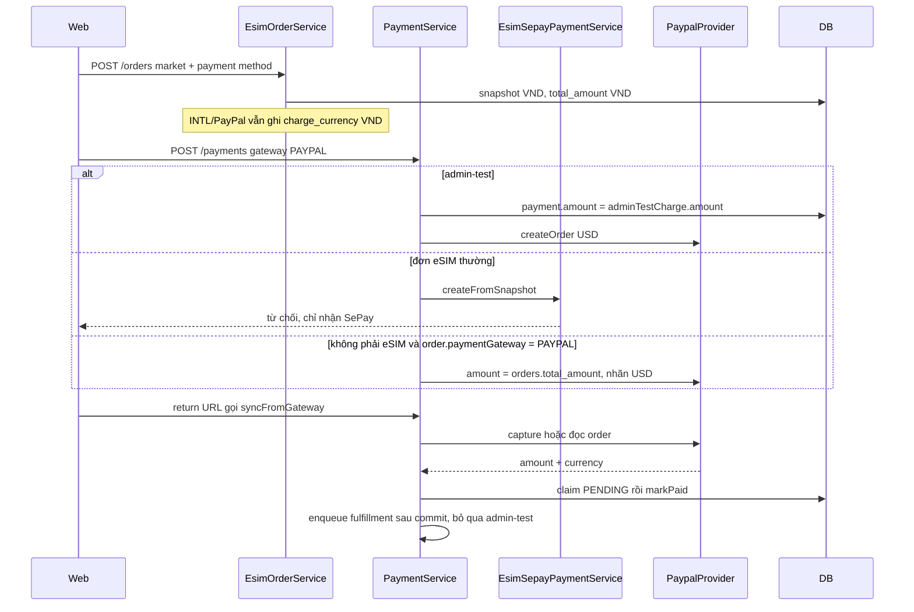

# Phase 2C.1 — PayPal USD readiness audit

Ngày: 2026-11-06. Chỉ đọc code và database local. Không sửa source, schema, migration, dữ liệu, env, container hay production. Không gọi PayPal API.

## 1. Executive Summary

PayPal trong code hiện chỉ tạo order cho **admin-test eSIM**. Khách eSIM chọn PayPal không đi tới PayPal: sau nhánh admin-test, mọi đơn eSIM rơi vào luồng SePay Phase 2B và bị từ chối vì gateway không phải SePay.

Admin-test gửi đúng số USD trong `clientTrace.adminTestCharge.amount`, không gửi `orders.total_amount`. Payment admin-test không ghi `payments.currency`, `product_lane` hay `fx_rate_id`.

Snapshot đơn eSIM đang được ghi luôn là VND, kể cả khi market là `INTL` và cổng là PayPal. Bảng `fx_rates` và `fx_rate_sources` trên local đang trống. Local có một đơn PayPal và một payment PayPal, cả hai `EXPIRED`, mọi cột snapshot tiền tệ đều null. Không có đơn nào đang có `charge_currency = USD`.

Webhook PayPal có xác minh chữ ký qua PayPal. Đường sync/capture đối chiếu amount và bắt currency phải là USD. Đường `PAYMENT.CAPTURE.COMPLETED` chỉ đối chiếu amount với `payments.amount`, không đối chiếu currency và không đối chiếu PayPal Order ID đã lưu. PAID dùng `claimPendingStatus` rồi `markPaidInTransaction` của bán lẻ. Fulfillment PayPal chạy sau khi transaction đó commit. Admin-test không enqueue.

Cổng production không được bật trong audit này. Env local để `PAYPAL_ESIM_ENABLED=false` và `PAYPAL_MODE=sandbox`, nhưng bản ghi admin `settings.payment.paypal` đang `mode=sandbox` và `esimEnabled=true`. Code ưu tiên giá trị trong database.

Phase 2C.2 chưa nên viết lệnh tạo PayPal khách cho đến khi đơn eSIM ghi được snapshot USD. Không backfill đơn `EXPIRED` hiện có. Không đụng SePay eSIM, VietQR, ví đại lý hay MegaPay.

## 2. Sơ đồ luồng PayPal hiện tại

## 3. File và module

| Vai trò | File |
| --- | --- |
| Tạo đơn eSIM và snapshot | `src/modules/esim/esim-order.service.ts`, `src/modules/esim/esim-order-snapshot.ts`, `src/modules/esim/esim-market.rules.ts` |
| Tạo payment, webhook, sync, PAID | `src/modules/payment/services/payment.service.ts` |
| Route webhook | `src/modules/payment/controllers/payment.controller.ts` |
| PayPal adapter | `src/modules/payment/providers/paypal/paypal.provider.ts`, `paypal.client.ts`, `paypal.rules.ts` |
| Cấu hình | `src/modules/settings/services/settings-store.service.ts`, `src/config/configuration.ts`, `src/config/production-env.rules.ts` |
| Claim payment | `src/modules/payment/repositories/payment.repository.ts` |
| Mark PAID bán lẻ | `src/modules/order/services/order.service.ts` |
| Web khách | `apps/web/lib/esim-paypal.ts`, `apps/web/app/checkout/CheckoutPageClient.tsx`, `apps/web/app/checkout/paypal/return/PaypalReturnClient.tsx` |
| Admin | `apps/admin/app/configuration/paypal/page.tsx`, `apps/admin/components/esim/AdminTestOrderDialog.tsx` |

Product lane thực tế: PayPal không phục vụ thẻ hay nạp. `paymentMethodsForCheckout` loại PayPal khỏi checkout không phải eSIM, và với eSIM chỉ để PayPal khi market `INTL` (`apps/web/lib/esim-paypal.ts` dòng 14–20). Backend vẫn chặn đơn eSIM thường ở bước tạo payment.

## 4. Tạo Payment và PayPal Order

Thứ tự trong `PaymentService.createPayment`:

1. Admin-test PayPal return trước (`payment.service.ts` dòng 156–158).
2. Đơn chỉ gồm item eSIM đi `EsimSepayPaymentService.createFromSnapshot` (dòng 159–168).
3. Phần còn lại lấy `orders.total_amount` và gán currency `USD` nếu gateway là PayPal (dòng 183–191, 240).

`createFromSnapshot` từ chối mọi gateway khác SePay ngay dòng đầu của service eSIM. Vì vậy đơn eSIM khách, dù `paymentGateway = PAYPAL`, không tạo PayPal Order và không tạo payment.

Admin-test:

- Số tiền lấy từ `clientTrace.adminTestCharge.amount` (`payment.service.ts` dòng 309–312, 355).
- Currency gửi sang PayPal là `USD` (dòng 431).
- `payments.amount` bằng số đó, không bằng `orders.total_amount`.
- Không ghi `currency`, `product_lane`, `fx_rate_id`.
- Khóa dòng order, chỉ giữ một payment PayPal `PENDING` hoặc `SUCCESS` (dòng 327–344).
- PayPal-Request-Id là `paymentReference`. Retry không tạo payment thứ hai. Quá 6 giờ thì manual review, không tạo order PayPal mới (dòng 410–419).

Đơn eSIM lúc tạo (`esim-order.service.ts` dòng 166–187, 241–245) luôn gọi `buildEsimVndPriceSnapshot`. Hàm đó gắn `catalog_currency` và `charge_currency` bằng `VND` (`esim-order-snapshot.ts` dòng 19–31). Market `INTL` chỉ được lưu vào `esim_market`. Không có nhánh ghi `charge_currency = USD`. Phí khách tính từ giá VND (`calculateCustomerPaid` trên `sellAmount` đã làm tròn đồng).

Không có chỗ nào đọc số tiền từ body frontend để tạo PayPal Order. Frontend return chỉ gọi `syncFromGateway` (`PaypalReturnClient.tsx`).

Câu hỏi audit:

| Câu hỏi | Code hiện tại |
| --- | --- |
| Số tiền lấy từ đâu? | Admin-test: `adminTestCharge.amount`. Khách eSIM: không tạo PayPal. Nhánh còn lại: `orders.total_amount` |
| Currency xác định ở đâu? | Cứng `USD` khi gọi PayPal, không đọc snapshot |
| `payments.amount` ghi thế nào? | Admin-test ghi số USD. Nhánh còn lại ghi `total_amount` |
| Có dùng `total_amount` không? | Có, ở nhánh sau eSIM. Admin-test không dùng |
| VND có bị gửi dưới nhãn USD không? | Đơn eSIM khách thì không, vì bị từ chối trước. Nhánh dòng 183–191 thì có, nếu một đơn `paymentGateway = PAYPAL` không bị nhận là eSIM-only |
| Có kiểm tra `product_lane` không? | Không, vì payment PayPal không ghi field này |
| Có kiểm tra snapshot USD trước khi tạo order không? | Không |
| Nhiều PayPal Order cho một payment? | Admin-test không. Index `payments_one_open_esim` không áp dụng vì `product_lane` đang null |

## 5. Capture và webhook

Route là `POST /api/v1/payments/webhook/:gateway` (`payment.controller.ts`). PayPal dùng chung route này. Agent deposit chạy trước; reference PayPal không phải mã nạp thì handler trả `handled: false`.

Chữ ký: `PaypalClient.verifyWebhookSignature` gọi `POST /v1/notifications/verify-webhook-signature` với `webhook_id` từ cấu hình (`paypal.client.ts` dòng 116–147). Thiếu header truyền dẫn hoặc `verification_status` khác `SUCCESS` thì webhook bị từ chối. `handleWebhook` ghi log rồi trả 401 nếu chữ ký sai (`payment.service.ts` dòng 511–540).

Webhook ID lấy từ `settings.payment.paypal.webhookIdEnc`, nếu không có thì `PAYPAL_WEBHOOK_ID` (`settings-store.service.ts` dòng 803–812).

`parsePaypalWebhook` lấy `custom_id` làm `paymentReference`, capture id và amount/currency khi event là `PAYMENT.CAPTURE.COMPLETED` (`paypal.rules.ts` dòng 299–336). Payment được tìm bằng reference đó.

Đối chiếu:

- Đường sync và `CHECKOUT.ORDER.APPROVED` đi `advancePaypal` → `planPaypalSettlement`. Currency khác USD hoặc amount lệch thì kế hoạch giữ `PENDING`, không PAID (`paypal.rules.ts` dòng 191–194). Test `paypal.checkout.spec.ts` phủ amount `103000.00` và currency `EUR`.
- Đường `PAYMENT.CAPTURE.COMPLETED` đặt status `SUCCESS` ngay trong `verifyWebhook` (`paypal.provider.ts` dòng 104–111). `handleWebhook` chỉ gọi `assertWebhookAmountMatches` (`payment-state.machine.ts` dòng 36–49). Hàm này so hai số tiền, không so currency, không so PayPal Order ID với `gatewayResponse.paypalOrderId`.

Capture lặp: `captureOrder` gặp `ORDER_ALREADY_CAPTURED` trả `unknown`, không tạo order mới (`paypal.client.ts` dòng 154–157). Plan khi capture state đã là `UNKNOWN`, `CAPTURING` hoặc `CAPTURED` thì đọc order, không gọi capture lần nữa (`paypal.rules.ts` dòng 158–163).

Webhook lặp sau khi payment đã `SUCCESS` trả duplicate và chỉ gọi `queuePaypalFulfillmentIfNeeded` (`payment.service.ts` dòng 626–634). Hai webhook đồng thời cùng thấy `PENDING` thì `claimPendingStatus` là `updateMany` với `status = PENDING` (`payment.repository.ts` dòng 103–114). Một bên `count = 1`. Bên kia `count = 0` và nếu đã `SUCCESS` thì coi là duplicate.

Capture thành công nhưng transaction PAID rollback: capture ở PayPal đã xảy ra. `persistPaypalPlan` ghi `captureState` bằng update riêng, ngoài transaction PAID. Lần sau plan không capture lại nếu state đã là `CAPTURING` hoặc `CAPTURED`. Không có refund tự động. `PaypalProvider.refund` trả thất bại và nói refund thủ công (`paypal.provider.ts` dòng 153–157).

`queryTransaction` của PayPal luôn trả `PENDING` (`paypal.provider.ts` dòng 137–142). Sync bán lẻ không thể đánh dấu PayPal là đã trả bằng poll chung.

## 6. Các đường sang PAID

| Đường | Điều kiện | Atomic | Dùng chung |
| --- | --- | --- | --- |
| PayPal webhook `PAYMENT.CAPTURE.COMPLETED` | Chữ ký đúng, amount khớp `payments.amount`, chưa hết hạn | `claimPendingStatus` rồi `markPaidInTransaction` trong một transaction | `markPaidInTransaction` là hàm bán lẻ |
| PayPal `CHECKOUT.ORDER.APPROVED` rồi capture/sync | Plan yêu cầu USD và amount khớp snapshot payment | Cùng hàm atomic | PayPal |
| `syncFromGateway` khi payment là PayPal | Cùng `advancePaypal` | Cùng hàm | PayPal. eSIM SePay return sớm, `synced: false` |
| `syncFromGateway` gateway khác | Query gateway trả SUCCESS | Cùng hàm atomic, rồi dispatch | SePay bán lẻ, MegaPay. PayPal không dùng vì query luôn PENDING |
| Manual review `approveManualReview` | Payment đang trong hàng review | `processManualReviewApprovalAtomically`, cùng kiểu claim | Bán lẻ và PayPal muộn |

`markPaidInTransaction` (`order.service.ts` dòng 416–444) đọc trạng thái rồi `order.update` theo id. Không có `updateMany` với điều kiện `payment_status = WAITING_PAYMENT`. Hai payment khác nhau của cùng một order có thể cùng đọc `WAITING_PAYMENT` trước khi một bên ghi PAID. eSIM SePay không đi đường này. PayPal đang đi đường này.

Fulfillment PayPal nằm sau khi `processSuccessWebhookAtomically` return (`payment.service.ts` dòng 686–688 và 954). Job id eSIM là `esim-fulfill-{orderId}`. Admin-test gặp `isPersistedAdminTest` thì ghi `fulfillmentSkipped = ADMIN_TEST` và không enqueue (dòng 1063–1069).

Payment `SUCCESS` mà order chưa PAID có thể xảy ra nếu `markPaidInTransaction` ném sau khi claim đã chạy trong cùng transaction: transaction rollback cả claim. Nếu crash sau commit và trước enqueue thì order đã PAID, `fulfillmentQueued` còn false. Webhook hoặc sync sau đó thấy `SUCCESS` và enqueue lại.

## 7. Schema và snapshot

Cột đã có, nullable, không default cho đơn cũ:

- Order: `catalog_currency`, `catalog_amount`, `charge_currency`, `charge_amount`, `cost_currency`, `cost_amount`, `fx_rate_id`, `fx_rate`, `fx_as_of`, `esim_market`, `pricing_locked_at`.
- Payment: `currency`, `product_lane`, `fx_rate_id`.
- Quote: các cột snapshot tương ứng trong `esim_order_quotes`.
- Index `payments_one_open_esim` chỉ chặn payment thứ hai khi `product_lane = 'ESIM'`.

Code ghi snapshot đơn eSIM chỉ điền currency VND, amount bán, market và `pricing_locked_at`. Không ghi `cost_currency`, `cost_amount`, `fx_rate_id`, `fx_rate`, `fx_as_of`. Payment PayPal không ghi ba cột payment mới. Payment SePay eSIM có ghi `currency = VND` và `product_lane = ESIM`.

Local, chỉ SELECT đếm:

| Chỉ số | Giá trị |
| --- | --- |
| `fx_rates` | 0 |
| `fx_rate_sources` | 0 |
| Payment PayPal | 1, status `EXPIRED`, `currency` null, `product_lane` null |
| Order `payment_gateway = PAYPAL` | 1, status `EXPIRED`, `charge_currency` null, `catalog_currency` null, `esim_market` null |
| Order PayPal có `charge_currency = USD` | 0 |

Đơn này tạo trước snapshot. Không được backfill. Admin-test mới sau Phase 1 vẫn để `charge_currency = VND` vì `buildEsimVndPriceSnapshot`, còn số USD chỉ nằm trong `clientTrace`.

## 8. Cấu hình Sandbox và Production

Biến env, không in secret:

| Biến | Local API container | Nơi đọc |
| --- | --- | --- |
| `PAYPAL_ESIM_ENABLED` | `false` | `configuration.ts` dòng 138. Bị đè nếu DB có boolean |
| `PAYPAL_CLIENT_ID` | rỗng | Fallback khi DB không có `clientIdEnc` |
| `PAYPAL_CLIENT_SECRET` | rỗng | Fallback khi DB không có `clientSecretEnc` |
| `PAYPAL_WEBHOOK_ID` | không có | Fallback khi DB không có `webhookIdEnc` |
| `PAYPAL_MODE` | `sandbox` | Fallback khi DB không có `mode` |
| `ESIM_USD_CHECKOUT_ENABLED` | không có | Chỉ có trong tài liệu thiết kế, không có trong `configuration.ts` |
| `ESIM_PAYPAL_CUSTOMER_ENABLED` | không có | Chỉ có trong tài liệu thiết kế, không có trong `configuration.ts` |

Database local `system_settings` key `settings.payment.paypal`: có `clientIdEnc`, `clientSecretEnc`, `webhookIdEnc`, `mode = sandbox`, `esimEnabled = true`. Giá trị secret không được đọc ra. `resolvePaypalConfig` dùng boolean DB trước env (`settings-store.service.ts` dòng 816–819).

Host API cố định trong code: sandbox `https://api-m.sandbox.paypal.com`, live `https://api-m.paypal.com` (`paypal.rules.ts` dòng 98–104). Probe live không gọi mạng (`paypal.client.ts` dòng 99–100). `production-env.rules.ts` từ chối `PAYPAL_ESIM_ENABLED=true` và từ chối `PAYPAL_MODE=live` khi thiếu client id, secret hoặc webhook id.

Production không được query. Không có bằng chứng cổng live đang bật trên VPS.

## 9. Test hiện có

Đã đọc spec, không chạy lại trong audit này.

| File | Phủ |
| --- | --- |
| `paypal-admin-test-payment.spec.ts` | 1.00 USD, không sửa order, một PayPal order, cửa sổ 6 giờ, từ chối LIVE |
| `paypal.checkout.spec.ts` | Chữ ký webhook, capture một lần, amount/currency lệch không SUCCESS, admin-test không enqueue |
| `paypal.rules` qua checkout spec | Market VN không được PayPal |
| `paypal-admin.spec.ts` | Không lưu placeholder, không bật cờ khi đổi mode, không probe LIVE |
| `paypal-limits.rules.spec.ts` | Trần USD |
| `esim-sepay-payment.spec.ts` | SePay eSIM từ chối PayPal |
| `esim-paypal.test.ts` | UI không coi return URL là đã trả |
| `payment.service.spec.ts`, `payment.sepay-webhook.spec.ts` | Claim và amount bán lẻ |
| `production-env.rules.spec.ts` | Cờ live và enabled |

Thiếu so với Phase 2C:

- Đơn eSIM `charge_currency = USD` tạo PayPal từ `charge_amount`.
- Đơn eSIM PayPal không bị nhánh SePay nuốt.
- `PAYMENT.CAPTURE.COMPLETED` sai currency không PAID.
- Webhook đúng chữ ký nhưng sai PayPal Order ID không PAID.
- Hai webhook đồng thời chỉ một PAID và một job.
- Snapshot thiếu, amount 0, FX hết hạn.
- Không đụng payment SePay eSIM và không enqueue admin-test.

## 10. Lỗi và rủi ro trong code hiện tại

1. Khách eSIM PayPal không thanh toán được. Nhánh Phase 2B nhận mọi đơn eSIM trước khi tới PayPal (`payment.service.ts` dòng 159–168).
2. Snapshot không có USD. `buildEsimVndPriceSnapshot` luôn ghi VND. Phase 2C không có số USD hợp lệ để gửi.
3. `PAYMENT.CAPTURE.COMPLETED` không kiểm currency và không kiểm order id đã lưu. Amount trùng là đủ để đi tới PAID.
4. `markPaidInTransaction` không khóa điều kiện trên `payment_status`. PayPal dùng chung hàm này với bán lẻ.
5. Index một payment eSIM đang mở không bảo vệ admin-test hiện tại vì `product_lane` null.
6. Cờ hiệu lực trên local là `esimEnabled=true` trong DB, khác env `false`.
7. Nhánh dòng 183–191 vẫn có thể gửi `total_amount` dưới nhãn USD nếu đơn PayPal không bị coi là eSIM-only. Đơn eSIM đủ item thì không rơi vào nhánh này.

Không sửa các điểm này trong 2C.1.

## 11. Kiến trúc đề xuất cho Phase 2C

Giữ nguyên thứ tự an toàn:

1. Admin-test PayPal return trước, vẫn dùng `adminTestCharge.amount`. Không đọc `charge_amount`. Không ghi đè đơn `EXPIRED` cũ.
2. Nếu đơn chỉ là eSIM và gateway là PayPal, đi service PayPal USD mới. Không vào `EsimSepayPaymentService`.
3. Service đó chỉ tạo PayPal Order khi `charge_currency = USD`, `charge_amount` lớn hơn 0, tối đa hai số thập phân, và snapshot chưa hết hạn theo quy tắc FX đã chốt. Thiếu một điều thì từ chối, không tạo order.
4. `payments.amount = charge_amount`, `payments.currency = USD`, `product_lane = ESIM`, `fx_rate_id` copy từ order nếu có.
5. Không đọc `total_amount`, không đọc số tiền frontend.
6. Đơn eSIM SePay VND giữ nguyên nhánh 2B.
7. Webhook và sync PayPal eSIM đối chiếu chữ ký, `custom_id`, PayPal Order ID, capture id, amount và currency với payment. Lệch thì không PAID.
8. Claim `PENDING` một lần. Fulfillment sau commit. Job id giữ `esim-fulfill-{orderId}`.
9. Capture đã thành công mà DB rollback thì lần sau chỉ đọc order, không capture lần hai, không refund tự động.
10. `PAYPAL_MODE` production và checkout khách production tiếp tục tắt.

## 12. File dự kiến từ Phase 2C.2

- `src/modules/payment/services/payment.service.ts` — rẽ PayPal eSIM trước nhánh SePay, sau admin-test.
- Service PayPal USD mới cạnh `esim-sepay-payment.service.ts`. Không sửa settlement SePay.
- `src/modules/esim/esim-order-snapshot.ts` và `esim-order.service.ts` — chỉ khi chủ dự án cho ghi snapshot USD. Đây là việc chặn 2C nếu chưa có tỷ giá.
- `paypal.rules.ts` — bắt currency trên cả event capture, đối chiếu order id.
- Spec mới. Không sửa kỳ vọng admin-test `1.00` và không sửa spec SePay eSIM.

Không sửa `sepay.auth.ts`, signer bán lẻ, webhook đại lý, MegaPay, VietQR.

## 13. Migration

Không cần migration mới. Cột snapshot và index eSIM đã có. Không backfill đơn cũ. Không điền USD cho đơn `EXPIRED` local.

## 14. Kiểm thử và nghiệm thu

- Snapshot USD hợp lệ tạo một payment, amount và currency bằng snapshot, một PayPal Order.
- Snapshot thiếu, currency không phải USD, amount 0, FX hết hạn: không gọi PayPal.
- Đơn eSIM VND vẫn vào SePay và vẫn bị từ chối nếu khách gửi PayPal.
- Admin-test vẫn gửi số trong `adminTestCharge`, không enqueue.
- IPN/capture đúng PAID một lần. Lặp không tạo job thứ hai.
- Sai amount, sai currency, sai order id: không PAID.
- Return URL không PAID khi chưa có capture khớp.
- Hai webhook đồng thời: một PAID.
- Capture thành công, transaction PAID lỗi: không capture lần hai.
- Webhook đại lý và failover MegaPay → VietQR vẫn như cũ.

## 15. Việc chủ dự án cần chốt trước khi code

1. Phase 2C.2 có được sửa chỗ ghi snapshot để đơn `INTL` lưu `charge_currency = USD` không, hay chỉ dựng cổng thanh toán và tiếp tục từ chối cho đến khi Phase tỷ giá ghi snapshot.
2. Khi chưa có dòng `fx_rates`, đơn USD có bị từ chối hết không. Local đang không có dòng tỷ giá nào.
3. Cờ khách PayPal. Local DB đang `esimEnabled=true` trong khi env là `false`. 2C.2 có được phép tạo PayPal khách trên sandbox local không, hay vẫn tắt khách và chỉ giữ admin-test.
4. `PAYMENT.CAPTURE.COMPLETED` sẽ bắt đầu đối chiếu currency và PayPal Order ID. Việc này nằm trên webhook PayPal chung, không nằm trên SePay. Cần xác nhận admin-test cũng chịu quy tắc USD này. Hành vi admin-test hiện đã yêu cầu USD trên đường sync.
5. PAID của PayPal eSIM có dùng tiếp `markPaidInTransaction` của bán lẻ, hay dùng update có điều kiện riêng như SePay eSIM. Đề xuất: update có điều kiện riêng cho `product_lane = ESIM`, không đổi hàm bán lẻ.

Dừng tại báo cáo này. Không triển khai Phase 2C.2.
